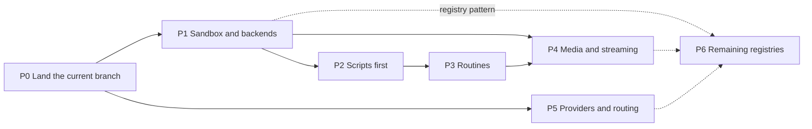

# Flexibility plan — 10 November 2026

Requested by the owner on 10 November 2026, after the [comparison with Hermes Agent and Grok Bot](hermes-grok-comparison-20261110.md). The owner chose five areas and one principle:

1. Media and streaming replies.
2. Model routing to all of Hermes' providers (about 45).
3. More powerful routines: cron and plain-language schedules, webhook triggers, script-only runs, quiet runs.
4. A sandbox and execution backends (local sandbox, Docker, SSH). This comes first.
5. Engine-side registries instead of a third-party plugin system.
6. **Scripts before the model.** The owner likes that Hermes writes a script and prefers running it over spending model steps, and wants the same in Tupies in a friendlier form.

This is a plan. Nothing in it is built. It was written against branch `feature/engine-capability-20261110` and Hermes Agent commit `3d4dd10`.

## Order

- **P1 is first** because every later phase adds a place where a bot works without the owner watching, and today nothing may run there without a card.
- **P2 follows P1** because a script is only cheap and friendly when it can run without an approval each time, and that needs the sandbox.
- **P5 depends on nothing else.** It touches the provider layer only and can run in a parallel session while P1–P3 are built.
- **P6 is not a separate block of work.** Each phase introduces its own registry (execution backends in P1, routine triggers in P3, channel adapters in P4, providers in P5). P6 converts what remains (search, speech) and adds the shared settings form.

Sizes are S, M, L for scope, not dates.

## P0 — Land the current branch (S) — done: PR #56 merged on 10 November 2026

The usage meter, quota handling, task budget and browser settle are uncommitted in this worktree. Commit, open a pull request and merge before P1, because P1 and P2 change the same engine files. `public/app.js` and `lib/api-native.mjs` also carry someone else's uncommitted chat-provider-switch work in the main checkout; that needs merging first or together.

## P1 — Sandbox and execution backends (L) — built on 10 November 2026 (source only); background-job wake-up not built

**What the owner gets.** In a bot's settings, one choice, "Where commands run":

| Choice | Meaning |
| --- | --- |
| Sandbox on this computer (recommended) | Commands can change only the bot's own folders. Ordinary commands run without asking, in every lane. |
| Docker container | Commands run in a container that sees only the bot's folders. |
| Another machine (SSH) | Commands run on a server the owner names. |
| This computer, ask me | Today's behaviour: no isolation, approvals as now. |

A status line under the choice says whether the backend works on this engine ("Sandbox ready", "Docker is not running"). If the chosen backend is unavailable, the bot falls back to asking for everything; it never runs unprotected silently.

**Engine design.**
- A registry of execution backends in `lib/exec/`. One interface: check availability, prepare a bot's environment, start a process (folder, environment, time limit, stop signal), describe itself for the settings screen. `terminal`, `execute_code`, background commands and saved scripts all start processes through it.
- **Sandbox backend.**
  - Mac: a Seatbelt profile generated per bot and run through `/usr/bin/sandbox-exec`. Writes are denied everywhere except the bot's workspace, its process home and a private temp folder. Writes are denied again inside those to `.git/hooks`, `.git/config` and shell profiles. Reads are denied to the engine's data folder, the vault key, other bots' folders, `~/.ssh` and keychains.
  - Linux: bubblewrap with the same rules. The engine data folder is not mounted at all.
  - The network stays open at first, as in Hermes and OpenBot. An egress filter is later work.
- **Docker backend.** The `docker` or `podman` command line, one container per bot, the workspace mounted read-write, a configurable image, no Docker socket inside the container.
- **SSH backend.** Host, user and key stored sealed like any credential; a fixed remote folder; one persistent connection per task.
- **Policy.** Inside a sandbox, container or remote machine, commands the classifier calls ordinary run unattended in routines, Telegram, rooms and delegated work. Dangerous commands still ask. Anything that must leave the sandbox asks with the exact command, as today. Approve for me keeps its meaning in the owner's chat.
- **Stop and restart.** The whole process group is ended on Stop; a restart interrupts and never replays.
- **Background jobs that report back.** `terminal` gets a "tell me when it finishes" option. When the job exits, the engine queues a task for the same bot and lane with the exit status and the end of the log, marked as data.

**Start with a spike.** A hand-written Seatbelt profile on the Mac engine, and bubblewrap under the VPS service's systemd hardening. The Docker command line is installed on this Mac; whether the daemon runs was not checked.

**Gate.**
- A routine installs a Python package and runs a script in its workspace with no card.
- The same script fails at the operating-system level when it writes to `~/.ssh` or reads the vault key.
- A dangerous command still shows its exact approval card inside the sandbox.
- Stop ends every child process. Docker and bubblewrap pass the same suite in the Linux container CI.

**Risks.** Seatbelt is deprecated by Apple but still works and is what OpenBot and Codex rely on. Tools that write outside the workspace (global package caches) will fail until their cache folders are redirected into the process home.

## P2 — Scripts before the model (M) — built on 10 November 2026 (source only); `execute_code` calling tools and retiring `shell_run` not built

**What Hermes does.** It writes scripts into a scripts folder and uses them in four ways: a script alone on a schedule with its output delivered as the message; a script that runs before the model and feeds it; a check that decides whether to wake the model at all; and `execute_code`, where one script calls several of the agent's tools. All of it is set up through tool arguments and files.

**What Tupies has.** `scripts_register` asks the model to supply a manifest with a hash of every file, each run needs an approval, and there are five overlapping execution tools. The routine workflow language is hand-written JSON. That is why bots rarely use scripts today.

**What the owner gets.**
- **A Scripts tab on each bot.** Every saved script has a name, a one-sentence description of what it does, its inputs as a small form, a Run button, the last result, how many times it ran, which routines use it, and the code behind a "View code" link.
- **"Save as a script" suggestions.** When a task repeated the same steps, or the owner asks for the same thing a second time, the reply ends with a card: "I can save this as a script, so next time it runs in seconds without the model." One click saves it.
- **Visible savings.** A script run shows "0 model calls" in the usage line.
- **One approval per version.** A new or changed script is shown once with what changed; inside the sandbox it then runs without asking.

**Engine design.**
- Two tools replace the manifest ritual: `script_save` (name, language, code, description, inputs) and `script_run`. The engine computes the hashes itself. `shell_run` and `scripts_register` are retired after a migration of existing script packages.
- Guidance, shown only to bots with Terminal: for work that is fully determined (fetch and parse, calculations, file conversion, checks, bulk edits) write and run a script instead of repeating tool calls, reuse a saved script when one fits, and offer to save a script after repeated work.
- `execute_code` may call the bot's own read tools from inside the script. Every call still passes the engine's admission and approval rules. A ten-step read-and-combine task becomes one model step.
- Scripts run through the P1 backends, so they are isolated by default.

**Gate.** A request such as "check these 30 URLs and tell me which are down" completes in at most three model steps on DeepSeek; repeating it offers to save a script; the saved script then runs from the Scripts tab and from a routine with no model call.

## P3 — Routines (M–L)

**What the owner gets: one routine editor screen.**

| Section | Content |
| --- | --- |
| When | A plain-language field ("every weekday at 9", "every 2 hours", "on the 1st of each month") or a cron expression. Under it, a preview: the parsed schedule, the time zone and the next three run times. |
| What | One of four kinds: **Ask the bot** (today), **Run a script** (no model; its output is the message), **Script, then the bot** (the script's output is given to the bot), **Check first** (a script or a web address is checked; when nothing changed the model is not woken). |
| Trigger | Besides the clock: an inbound web address with a secret, with Copy, Rotate and Send test buttons. |
| Deliver to | The bot's chat (default) or a connected Telegram chat. |
| Quiet | "Only tell me when there is something to report." A failed run is never quiet. |

Routines can still be created by describing them in chat; the confirmation card shows the same five sections.

**Engine design.**
- **Schedules.** A fifth schedule kind for five-field cron expressions and monthly dates. Plain language is parsed by a deterministic parser for common phrases; anything else goes through the bot, and the owner confirms the parsed result. The existing interval, daily, weekly and once kinds stay.
- **Run kinds.** A routine gets a `kind` and an optional script. Script-only and check-first runs never call a model and record a usage summary with zero model calls. The check compares the script's or the address's output with the previous run.
- **Quiet runs.** The bot signals "nothing to report" through a small tool; the engine then sends no message and no notification. Errors always notify.
- **Triggers.** A registry of trigger types. The first is a signed webhook: a signature over timestamp, id and body, a five-minute clock allowance, duplicate ids refused for seven days, a per-routine rate limit, and the payload stored with the run and given to the bot as data, never as instructions.
- **Hygiene.** A run is skipped while the previous one is still running. Missed runs collapse into one recorded skip. Each run gets a fresh session, and a short digest goes back to the chat.
- **Who may change automations.** A task started by a routine, a webhook, a Telegram message, a room or another bot cannot create or change routines, scripts or triggers.
- **The workflow language is retired.** Existing workflow routines are converted to script steps.

**Gate.** "Every weekday at 9, check my site and message me only if it is down" is set up from chat, runs as check-first with zero model calls on a normal day, and sends one message when the check fails. A signed webhook starts a routine once; a replayed or unsigned request is refused.

## P4 — Media and streaming replies (L)

**Scope note.** "Streaming replies" already work in the Tupies app (live text, thinking and tool strip). This phase brings media and streaming to messaging channels, starting with Telegram, and closes the remaining app gaps.

**What the owner gets in Telegram.**
- **Media in.** A photo is seen by a vision model. A document is read with the existing document readers. A voice note is transcribed and answered (uses the speech setting the owner already consented to).
- **Media out.** Files the bot produced arrive as documents, images as photos.
- **Streaming.** The reply appears as one message that grows, with "typing…" while tools run. Formatting (bold, lists, code, links) is preserved.
- **Buttons.** Approvals and questions arrive with Approve / Deny or answer buttons. Only the owner's Telegram account can press them; a button answered elsewhere changes to "answered in Tupies".
- **Groups.** One shared conversation per group with sender names; the bot answers when mentioned.

**What the owner gets in the app.** Images shown inline in replies, paste and drag-and-drop for attachments with progress, and live streaming in team rooms.

**Engine design.**
- A registry of channel adapters in `lib/channels/`. One interface: receive a normalized message (text, attachments, sender, chat), send, edit, typing, send a file, buttons, and a list of what the platform supports. Telegram is rebuilt on it; Discord and Slack later need only an adapter.
- Incoming media goes through the existing attachment admission (private paths, real file type, size limits) before a task starts.
- Streaming edits one message at most once a second and falls back to a single final message when editing fails. Delivery intents are still recorded before sending, and an ambiguous delivery is not re-sent.
- Buttons carry a random token bound to the approval's digest, the task's execution generation and the owner's Telegram user id. Details shown in chat are redacted and capped.
- Outgoing files are only verified artifacts, as in the app.

**Gate.** A photo sent on Telegram is described; a voice note is answered; a requested PDF arrives as a document; a long answer streams in one message; an approval is granted from a button and an outdated button is refused.

## P5 — Providers and routing (M–L)

**What Hermes' "45 providers" are.** Its 40 provider folders fall into four groups:

| Group | Count | Examples | Work in Tupies |
| --- | --- | --- | --- |
| Already in Tupies | 16 | OpenAI, ChatGPT, Anthropic, xAI, OpenRouter, DeepSeek, Gemini, Groq, Mistral, Together, Fireworks, Z.ai, Moonshot, MiniMax, Ollama, custom | None |
| Same protocol, new address | about 22 | Vercel AI Gateway, Alibaba DashScope, Alibaba Coding Plan, Arcee, DeepInfra, GMI, Hugging Face, Kilo Code, Nebius, Novita, NVIDIA NIM, Ollama Cloud, OpenCode Zen and Go, StepFun, Upstage, Xiaomi MiMo, Tencent TokenHub, Kimi Coding, LM Studio, Meta, Ramp Router, CommandCode | One data row each |
| New protocol or sign-in method | 3 | Amazon Bedrock, Google Vertex, Azure Foundry | A new adapter each |
| Subscription sign-in | 4–5 | Nous Portal, xAI, Qwen, MiniMax, Anthropic token paths | A sign-in flow each, only where the provider documents a public one |

**What the owner gets.**
- **Add provider on one screen.** A searchable gallery, paste the key, Test, then a model picker that shows each model's context window, price and reasoning support.
- **Honest labels.** A provider checked with a real key says "Verified". The others say "Preset, not yet checked with a real key".
- **Routing settings.** An ordered list of backup models per bot; several keys per provider; a model for each side job (summaries, reviews, titles, image description, action review) on one screen; a model per routine.
- **Dollars everywhere.** The usage line shows a cost for direct providers too.

**Engine design.**
- **A provider registry as data.** Each row: id, name, address, protocol, sign-in method, reasoning mapping, known quirks, sign-up link, known context windows. The 16 existing types move into it; adding a compatible provider is a row and a test.
- **New adapters.** Bedrock (request signing and its Converse protocol), Vertex (service-account sign-in), Azure Foundry (resource address and API version).
- **Subscription sign-ins.** Only flows a provider publishes for third-party clients. The project rule stands: no borrowed tokens, no private client ids, no undocumented endpoints. Each one is a separate owner decision.
- **Backup chain.** Replaces the single fallback. Each model is tried at most once per task. A task that has not yet acted is re-sent; a task that has acted continues on the backup with its completed steps, and no tool is replayed.
- **Key pools.** Several keys per connection, rotated on rate limit, spent quota or rejected key, before the backup chain.
- **Quota holds.** A spent plan window holds that connection and model for routines and inbound messages until the reset, saved to disk; a message from the owner may try once.
- **Prices.** A cached copy of the models.dev price list, each entry with its source and date; unknown stays unknown. The provider's own cost report still wins.

**Gate.** Every row passes a recorded-fixture test; every provider the owner holds a key for passes a live one-question check; with the primary made to fail, a task moves down a three-model chain without replaying a tool; two keys rotate on a rate limit.

## P6 — Registries, not plugins (S–M, spread across phases)

**The rule.** A registry entry is engine code: it lives in the repository, is reviewed, tested and shipped inside the signed engine release. Nothing is loaded at run time from a workspace, a download or a model's output. That keeps Hermes' "add a backend by adding a module" without its plugin attack surface.

| Registry | Introduced in | First entries |
| --- | --- | --- |
| Execution backends | P1 | host, sandbox, Docker, SSH |
| Routine triggers | P3 | clock, signed webhook |
| Channel adapters | P4 | Telegram |
| Model providers | P5 | the provider table above |
| Search and page reading | P6 | Exa, DuckDuckGo, Brave, Tavily, SearXNG (existing code moved) |
| Speech | P6 | OpenRouter dictation and voices, browser speech (existing code moved) |

- **One settings form.** Each entry declares its fields (name, type, secret or not, help text). The settings card for it is generated, so a new backend gets its screen for free and all of them look the same.
- **One contract test per registry**, run against every entry.
- **Developer note** in `docs/development.md`: how to add an entry.

## Every phase

- Regressions with the change; the full suite before merging; the real browser for every screen.
- `PROJECT_CONTEXT.md`, `docs/roadmap.md` and the relevant docs updated.
- Installation by the engine release runbook, VPS first, only when the owner asks.

## Decisions for the owner

| # | Decision | Recommendation |
| --- | --- | --- |
| 1 | Existing bots with Terminal: move them to the sandbox automatically once P1 passes its tests? | Yes on the Mac and VPS engines, with "This computer, ask me" one click away. |
| 2 | Retire `scripts_register`, `shell_run` and the routine workflow language, with migration? | Yes. |
| 3 | Channels in P4: Telegram only, or Discord and Slack in the same phase? | Telegram only; the adapter interface makes the others small follow-ups. |
| 4 | Providers: ship all compatible presets with the "not yet checked" label, or only the ones verified with a real key? | Ship all, labelled. |
| 5 | Which subscription sign-ins to pursue? | xAI and Nous Portal first, each only after its public flow is confirmed. |
| 6 | Network inside the sandbox: open at first? | Yes, as in Hermes and OpenBot; filter later. |

## Not in this plan

Discord, Slack, WhatsApp and email adapters; stdio MCP and more skill sources; an OpenAI-compatible endpoint; session branch, rewind and export; image and video generation; a live voice call; a vault for site logins. They remain in the [comparison](hermes-grok-comparison-20261110.md) for a later round.
