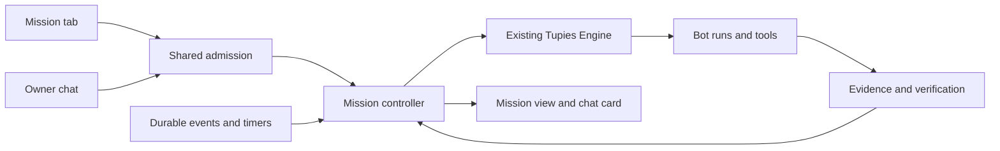

# Mission — план реалізації

Дата: 1 листопада 2026 року. Статус: запропонований план, підготовлений за запитом власника. Mission ще не реалізовано. План охоплює інтерфейс, запуск із чату, керування довготривалою ціллю та поступове розширення автономного виконання.

## Продуктовий результат

Користувач задає результат, а Tupies веде роботу до перевіреного завершення або пояснює конкретну причину, чому продовжити неможливо. Одна Mission може об'єднувати кілька запусків, ботів, інструментів, очікувань і артефактів. Власний Tupies Engine зберігає відповідальність за виконання, дозволи та стан.

**Mission — окрема головна вкладка.** Створення у цій вкладці та створення зі звичайного чату ведуть до одного запису й одного контролера. У чаті залишається картка з посиланням; вкладка показує ціль, перевірений прогрес, поточні дії, учасників, результати й потрібні рішення користувача.

Власник уже визначив назву Mission, окрему вкладку, два способи запуску та автоматичне розпізнавання однозначного наміру. Решта рішень нижче — запропоновані робочі defaults для реалізації. План не є дозволом на розгортання чи нові зовнішні дії.

## Що використати з поточного продукту

| Наявна основа | Використання в Mission | Потрібне доповнення |
| --- | --- | --- |
| Engine, work-until-done, plans, Stop | Виконання окремих епізодів роботи | Довговічна ціль над кількома епізодами |
| Outcome checks і delegated deliverables | Перевірка файлів, команд, спостережень і результатів колег | Обов'язковий контракт приймання всієї цілі |
| DelegationJobs | Реальні учасники, черга, результати, виправлення, захист від циклів | Залежності та відновлення між епізодами Mission |
| Checkpoints і work receipts | Збереження прогресу без сліпого повторення ефектів | Довші очікування, незалежне зберігання доказів, звіряння невідомих операцій |
| Approval, Workshop, REST/MCP, browser, Scripts | Наявні дії та межі доступу | Пізніше — дозволи на визначені класи автономних дій |
| Brain, Learning, Skills | Збереження знань і перевірених процедур | Оцінювання повторного застосування та результативності |
| Dashboard, chat cards, notifications, mobile shell | Відображення реальних подій, результатів і запитів | Mission list/detail та спільні картки в чаті |

Поточна механічна перевірка без оголошених критеріїв повертає `passed:null`, а звичайний запуск може завершитися `completed`. Для Mission це не буде підтвердженням досягнення цілі. Наявне відновлення також не відновлює автоматично перервану команду делегованих задач. Ці можливості потрібно додати, а не вважати готовими. Див. [Engine](../../lib/engine.mjs), [work quality](../../lib/work-quality.mjs), [delegation jobs](../../lib/delegation-jobs.mjs), [routines](../routines.md).

## Інтерфейс і щоденне використання

### Навігація

Порядок основних розділів: **Dashboard / Bots / Mission / Team rooms / Routines**. Mission доступна в desktop sidebar і як п'ята вкладка на телефоні. На вузькому екрані Team rooms можна підписати Rooms зі збереженням повної доступної назви. Маршрути: `#/missions` і `#/missions/:id`.

Зберегти поточний pearl/glass стиль, аватари, типографіку, світлу/темну тему та мобільні переходи. На телефоні перевірити п'ять вкладок на 320 px, збільшений текст, safe areas і клавіатуру. Повернення між Mission і чатом зберігає draft та позицію прокрутки. Dashboard отримує короткий блок активних Mission із посиланнями.

### Список Mission

Угорі: назва, **New Mission**, пошук і фільтри **Active / Needs you / Finished / All**. Спочатку показувати місії, що потребують рішення, потім активні за останньою змістовною зміною. Heartbeat не піднімає картку в списку.

Картка містить назву цілі, короткий очікуваний результат, головного бота, аватари фактичних учасників, стан, поточну дію, progress bar з підписом «3 з 5 результатів перевірено», час останнього підтвердженого оновлення. Під час очікування показувати подію або час наступного пробудження. На картці достатньо однієї контекстної дії: Answer, Review, Resume або Open result.

### Детальна сторінка

Перший екран: ціль, стан, відповідальний бот, progress bar, що відбувається зараз і доступні керування. Питання чи погодження, яке блокує роботу, видно без пошуку в журналі.

| Блок | Зміст |
| --- | --- |
| Goal | Початкове формулювання, обов'язкові результати, критерії та їхній стан |
| Now | Реальні активні кроки, черга, залежності, причина очікування |
| Team | Координатор, залучені боти, їхні конкретні задачі та результати |
| Results | Перевірені документи, файли та зовнішні записи з доказами |
| Activity | Призначення, суттєві рішення, перевірки, блокери, відновлення й зміни користувача |
| Resources | Використано, зарезервовано, залишилось; окремо невідомі величини |

Desktop використовує основну колонку для роботи/результатів і бічну для команди/ресурсів. На телефоні — послідовні блоки з розкриттям другорядних деталей. Приватні міркування моделі, сирі JSON-події, credential metadata та внутрішні IDs не є продуктовим інтерфейсом. Перелік учасників походить із фактичних призначень, а не зі списку доступних колег.

### Створення у вкладці

Мінімальна форма: **що потрібно отримати** та **відповідальний бот**. Доступного бота можна підставити з поточного контексту. За додатковими параметрами — джерела/вкладення, критерії, бажані учасники, строк, ліміти та engine виконання. Вкладення проходять звичайне зберігання й admission лише після Start.

**Start Mission** зберігає запис і ставить роботу в чергу без другого загального підтвердження. Бот уточнює лише те, без чого неможливо визначити результат або діяти. Зрозумілі критерії він формує сам і відразу показує; невизначеність у змістовній вимозі оформлює одним конкретним питанням. Зайнятий бот означає Queued із поясненням; його поточну задачу не зупиняти.

## Запуск зі звичайного чату

### Правила розпізнавання

| Намір користувача | Поведінка |
| --- | --- |
| «Створи Mission…», «Веди це як місію…» | Створити й показати картку; коротка задача теж може бути Mission за явним вибором |
| Однозначне доручення самостійно довести конкретну ціль до результату, з етапами/учасниками/очікуваннями | Автоматично додати в Mission і продовжити ту саму роботу |
| Невизначене обговорення або звичайний запит | Продовжити чат; за доречності показати необов'язкову дію Create Mission |
| Питання про Mission, запит лише на план, цитата, гіпотетичний приклад | Не запускати Mission |
| «Не створюй Mission», «Залиш це звичайним чатом» | Поважати явний вибір для цього доручення |

Довжина повідомлення, гроші, кількість пунктів або саме слово Mission недостатні. Розпізнавання спирається на новий авторський запит власника та дозволений контекст його розмови. Вкладення, сторінки, Skills, пам'ять, відповіді інструментів і повідомлення колег не можуть підмінити цей намір.

Використати структуроване рішення моделі з прив'язкою до реального owner message, а не регулярний вираз чи довільний `confidence:0.99`. Розрізняти `explicit`, `clear_goal`, `ambiguous`, `ordinary`. Якщо намір ще не встановлено, а класифікатор недоступний або суперечливий, звичайний чат працює далі. Уже встановлений явний текстовий запит зберігається з owner message і не понижується до ordinary через наступний збій: реєстрація відновлюється без повторного запуску задачі. Явний UI-вибір Mission не залежить від класифікації. Не додавати окремий оплачуваний виклик на кожне повідомлення, якщо рішення можна отримати в наявному першому кроці.

### Одна реєстрація і жодного повторного запуску

Усі входи користуються спільним admission. Транзакційно пов'язувати `missionId`, owner submission/message, root run, початкову версію контракту та receipt створення. Повтор після втраченої відповіді повертає той самий результат; той самий ключ з іншим payload відхиляється. Зберігати цю ідентичність протягом життя Mission, незалежно від короткого retention звичайних chat submissions. Семантична схожість двох доручень не є ключем дедуплікації.

Якщо виконання вже почалося, promotion приєднує наявний run, його snapshots і перевірені receipts. Не пересилати початковий prompt заново, не переносити активну canonical history між lanes і не повторювати дії. Нові епізоди мають окремий Mission lane; картка початкового чату лишається посиланням на той самий запис. Owner follow-up явно прив'язаний до обраної Mission; довільне нове повідомлення боту не приєднується до неї автоматично.

Початковий scope — вкладка Mission та прямий owner chat. Telegram, rooms і routines зможуть посилатися на місії пізніше через окремі явні маршрути. Делегат виконує підзадачу поточної Mission, а не створює нову незалежну місію зі слів іншого бота.

## Контракт, перевірка і progress bar

### Незалежні сутності

**Контракт** зберігає ціль, обов'язкові результати, критерії приймання, обмеження й правила завершення. **План** містить змінювані робочі кроки. **Run** — конкретний епізод роботи бота. **Evidence** — перевірене спостереження з джерелом, часом і точним об'єктом/версією. **Grant** — окремо виданий власником дозвіл; контракт або план його не замінює.

Кожна вимога має сталий ID, джерело в запиті власника, verifier і посилання на докази. Модель пропонує критерії; Engine перевіряє схему, джерельні посилання та наявність перевірки для кожної зафіксованої вимоги. Повноту змістового охоплення запиту оцінює окремий reviewer за рубрикою; сам schema check її не доводить. Зафіксовані вимоги не можна прибрати, послабити або замінити успішнішою перевіркою через редагування плану. Явна зміна власника створює нову версію контракту, зберігає попередню й запускає повторну перевірку залежних результатів.

Підтримати формальні перевірки артефактів/даних і незалежні checkers для коду/зовнішнього стану. Для досліджень та інших змістових задач — окрема оцінка за фіксованою рубрикою з джерелами; її позначати як модельну оцінку, а не математичний доказ. Людське приймання потрібне лише коли це частина критерію або модель не може обґрунтовано оцінити результат. Не запитувати його для кожної місії за замовчуванням.

Виконавець не може редагувати авторитетний checker або підмінити тест, яким його приймають. Створені ним тести можуть доповнювати перевірку. Заявка на finish переводить Mission у Verifying. `run.completed`, план із галочками, exit code 0 або самоствердження бота не завершують Mission. Порожній контракт чи неперевірений обов'язковий критерій не допускають Achieved.

### Розрахунок прогресу

Для першої версії використовувати рівні ваги обов'язкових результатів, включно з фінальним прийманням:

`progress = verified required outcomes / all required outcomes`

Показувати дріб поруч зі шкалою й пояснювати, що це частка підтверджених результатів, а не відсоток витраченого часу. До фіксації критеріїв — невизначена шкала та «Визначаємо критерії». Підкроки плану, tool calls і текст моделі не змінюють знаменник. За потреби нерівні ваги додавати пізніше як версійовану властивість контракту, не як поточну оцінку моделі.

100% з'являється в тому самому commit, що й Achieved, після фінальної звірки актуальних доказів. Зміна файлу, застарілий зовнішній стан або зміна scope можуть повернути критерій у перевірку й знизити прогрес; показувати причину. Завершена Mission зберігає доказ стану на момент приймання та точну версію результату; пізніші зміни позначають актуальність, не переписують історію непомітно. Вигаданих ETA, відсотків за часом і «майже готово» на підставі кількості викликів не буде.

## Життєвий цикл і керування

Зберігати окремо execution state (`draft`, `queued`, `running`, `waiting`, `pausing`, `paused`, `verifying`, `stopping`, `terminal`) та outcome (`achieved`, `blocked`, `budget_exhausted`, `expired`, `stopped`, `failed`). Для waiting потрібна структурована причина: owner input, approval, dependency, external event або provider recovery. Blocked зберігає перевірені часткові результати й може отримати нову спробу після усунення причини.

| Дія | Семантика |
| --- | --- |
| Add direction | Наступна безпечна межа; не змінює права й не скасовує обов'язкові результати |
| Change goal | Явна owner revision із переглядом залежних кроків/перевірок; не приховане редагування плану |
| Pause | Durable заборона нових дій/пробуджень, узгоджене припинення або завершення поточної bounded дії, збереження resumable стану |
| Resume | Повторна перевірка дозволів, snapshots, ресурсів і невідомих ефектів перед продовженням |
| Stop | Спочатку durable cancellation, потім drain дітей/процесів; жодного автоматичного воскресіння |
| Try again | Явна нова спроба зі збереженням історії, звіркою вже виконаного та без скидання використаного бюджету |
| Archive | Прибрати завершену місію з активного списку; зберегти результати й історію |

Pause показувати лише після реалізації справжньої семантики. Невідомий зовнішній ефект не називати безпечно призупиненим. Stop/Pause не означають скасування вже прийнятої сервісом зміни. Архівування не зупиняє активну роботу й не видаляє докази.

Питання/погодження в чаті й Mission використовують один authoritative prompt identity і generation. Відповідь на одній поверхні прибирає контроль на другій. Не дублювати запити чи дозволи. Повідомлення надсилати на потрібну дію, суттєвий блокер або завершення; звичайний heartbeat і зміна підкроку не створюють push. Використати існуючі правила attended suppression, stale-question cancellation і home delivery.

## Архітектура виконання

### Зберігання й атомарність

На першому етапі тримати компактні `missions`/`missionRuntime` у поточному serialized Store, щоб створення, promotion, budget reservation і запуск мали спільну commit-межу. Великі evidence payloads та журнали зберігати engine-local поза model-editable workspace; спочатку stage bytes, потім commit hash/path receipt. Startup звіряє staging/receipts без повторного виконання інструментів. Дані Mission не залежать від pruning run history або in-memory tool-result handles.

Мінімальні поля: `id`, `schemaVersion`, `revision`, `contractVersion`, `origin`, `ownerEngineId`, `leadBotId`, `participantAssignments`, `goal`, `requirements`, `state`, `outcome`, `reason`, `episodeRefs`, `evidenceRefs`, `resourceLedger`, `waitCondition`, `createdAt`, `updatedAt`. Історію контрактів/спроб та idempotency receipts зберігати окремо від поточного короткого UI snapshot. Секрети не копіювати в ці поля.

Мутації й controls використовують очікувану revision. Довгі журнали, пагінація та retention мають окремі ліміти; незавершені операції й докази обов'язкових результатів не зникають через звичайне очищення історії. Нові state-поля не включати в загальний polling чи sync без явної санітизованої проєкції. Виміряти вартість whole-state commits і потребу винести історію зі `state.json`; міграція на Postgres не є умовою першого релізу.

### Епізоди, команда і ресурси

Mission controller викликає наявний Engine через один lifecycle/tick; не створює паралельного scheduler для тих самих дій. Зберігаються один active run на бота та загальний concurrency limit. Кілька місій можуть чекати одного бота; queue fairness і причина очікування видимі. Довгі waiting missions після етапу durable waits звільняють виконавчі слоти.

Кожне admission повторно перевіряє доступність бота, provider identity та права, включно з queued/waiting Mission. Видалення/вимкнення потрібного бота, connection або доступу дає Needs attention без мовчазної заміни виконавця. Mission history/evidence зберігаються зі snapshot підписами видалених учасників. Owner reassignment і next-run model changes проходять явні revision/identity правила; вони не переписують попередні спроби.

Продовження перерваного епізоду зберігає його оригінальні model/reasoning/capability snapshots. Новий епізод може застосувати налаштування next run; контракт і дозволи місії залишаються обов'язковими. Opaque reasoning переноситься лише за вже підтриманою сумісністю provider/connection/model.

Координатор може обирати колег із дозволеного набору й доручати їм підзадачі. Права визначаються перетином місійного scope, власних поточних прав бота та snapshot епізоду. Наявність учасника в Team не дає йому доступ до чужого workspace. Для потрібних спільних результатів використовувати явні bounded передачі копій/витягів з provenance; приватні histories не підмішувати.

### Engine ownership і sync

Спочатку одна Mission має одного закріпленого execution owner engine. Для запуску зі вкладки це явно показаний обраний engine; для promotion — engine вже активного run. Для багатоденної роботи рекомендувати Home, але не переносити туди поточне виконання автоматично.

Інші engines отримують лише санітизовану проєкцію: ціль, учасники, стан, прогрес, safe result references, owner engine, revision і freshness. Вона не містить approval identities, raw journals, бюджетної authority чи grants і не може запускати роботу. Remote control веде до чинної авторизованої workspace API-сесії owner engine; при недоступності показується стан останнього підтвердження.

Існуюча presence та її expiry не є distributed lease. Втрата зв'язку або старий LWW snapshot не дозволяють другому engine продовжити ту саму місію. Автоматичний failover відкласти; майбутній transfer потребує quiescence, звіряння операцій, owner epoch/fencing і неможливості роботи старого owner. Routine/channel scheduling та ChatGPT renewal ownership залишаються за поточними правилами.

## Поетапна реалізація

| Етап | Обсяг | Видимий результат | Залежності |
| --- | --- | --- | --- |
| A | Контракт, admission, episode links, evidence, verifier | Mission існує як перевірювана ціль | Наявний Engine |
| B | Mission UI, chat cards, promotion і розпізнавання | Запуск і трекінг із вкладки та чату | A |
| C | Спільні ресурси й прозорий облік | Бюджет усієї команди, без гонок | A; UI з B |
| D | Durable waits, Pause/Resume, recovery дерева | Робота через довгі очікування й перезапуски | A–C |
| E | Scoped grants і зовнішні operation adapters | Автономні зовнішні дії в заданих межах | C–D |
| F | Загальний ізольований code worker | Довші Python/Node задачі з перевіреними артефактами | C–E для зовнішнього доступу |
| G | Досвід, оцінювання та довга експлуатація | Вимірювана якість і повторне використання | Базові evals починаються в A; підсумковий gate після F |

### A — контракт і базовий контролер

Реалізувати схеми, revision/CAS, атомарне create/adopt, чергу першого епізоду, source-bound requirements, evidence store та final verification. Додати dedicated Mission lane для нових епізодів. Пов'язати наявні plans/delegations/receipts без другого executor.

Окремо підключити owner-bound Mission lane до `ask_user`, спільних question/approval identities, notification attention і приватного browser handoff: нинішні chat-only guards не переносити простим перейменуванням source. Доступ до цих owner controls має координатор у власницькій Mission, а не будь-який делегат. Checkpoints мають зберігати `missionId`, contract revision та episode identity. У першому релізі дозволити перевірене відновлення безпечного одиночного епізоду; pending children та unknown effects залишають Needs attention до етапу D. Adopted chat checkpoint також зберігає Mission identity, щоб restart не обходив її success gate.

Дати моделі вузькі інструменти на кшталт `mission_start`, `mission_status`, `mission_plan_update`, `mission_submit_result`, `mission_request_completion`. Назви уточнюються під час реалізації; жоден із них не може напряму виставити Achieved, довільний відсоток або створити grant. Authoritative controls залишаються owner API. До появи загальної recovery зберігати нинішню відмову на невідомих ефектах і перерваних делегаціях та показувати Needs attention.

**Gate:** повторне створення/втрачена відповідь/crash між admission і dispatch не дублюють запис або роботу; відсутні критерії, змінені файли та невиконаний required child блокують успіх. Питання з Mission вирішується один раз у чаті або вкладці; restart після promotion зберігає прив'язку й перевірки. Відкликання доступу та видалення queued учасника не запускають роботу й не видаляють докази. Простий дослідницький/документний сценарій завершується з актуальними доказами.

### B — повний користувацький шлях

Додати п'яту вкладку, list/detail, форму створення, учасників, progress bar, results, activity, Stop і Add direction. З'єднати chat card та Mission з одним станом. Реалізувати explicit запуск і promotion, потім conservative auto-recognition з негативним корпусом; обидва способи входять у перший користувацький реліз після проходження gate. Pause до етапу D не показувати.

Не перетворювати всі складні запити на місії й не вимагати підтвердження очевидного доручення лише через новий інтерфейс. Додати пошук, порожні/офлайн стани, коректне unread/notification routing і представлення remote summary без локальної authority.

**Gate:** фактичний браузер на 320/390 px, tablet і desktop; світла/темна тема, keyboard, reduced motion, великий текст, довгі назви, багато учасників, швидка навігація та оновлення під час редагування. Chat і Mission показують один ID/прогрес; promotion не повторює вже виконану дію. Явні й однозначні позитивні сценарії та цитовані/гіпотетичні негативні сценарії проходять окремо.

**Перший придатний реліз — A+B.** Він дає реальні дослідницькі/документні місії, існуючу командну роботу, докази й два входи. Зберігає чинні action approvals; загальний monetary cap, довгі event waits, Pause і recovery незавершеної команди ще не обіцяються. Ліміти, яких Engine не вміє забезпечити, не показувати як активні налаштування.

### C — ресурси всієї Mission

Додати один engine-owned ledger із `reserved`, `settled`, `unknown` та атомарним резервуванням до dispatch. Усі діти/спроби витрачають ресурси тієї самої Mission. Охопити основні model calls, intent classification, compaction, memory/final review, study/vision та verifier inference; облік лише в основному циклі не є повним бюджетом. Promotion переносить уже відомі витрати й незавершені резерви початкового run один раз; це не початок нового безкоштовного лічильника.

Окремо рахувати model tokens/known prices, API request counts, compute, wall deadline та доменні ресурси. Суму вже використаного не скидати після retry, Pause або нового епізоду. Невідомий usage залишати reserved/unknown. Для subscription не вигадувати доларову ціну чи залишок зовнішньої квоти. Резерви й remote billing estimates мають чіткі межі точності; локальний admission ceiling не називати гарантією рахунку провайдера.

Власник задає ліміти або використовує явні workspace defaults. Зберегти work-until-done без прихованого старого time/turn cap; заданий ресурсний ліміт завершує або блокує місію відповідним outcome. Залишити резерв на перевірку й узгоджене завершення запущених операцій. Додати читабельну capability readiness: доступно, немає інструмента, потрібен доступ, невідома ціна; використати існуючі catalogs, не створювати дубль усіх tools.

**Gate:** одночасні діти не витрачають один залишок двічі; Stop та зміна ліміту виграють гонку з новим dispatch; втрачений usage і restart не обнуляють витрати; failure не зараховується як успішне дешеве завершення.

### D — очікування та відновлення

Зберігати typed wait condition, deadline, dedupe key, event cursor і наступний wake. Спочатку підтримати timer, завершення залежного епізоду та вузький переглянутий read-only watcher. Звичайний код перевіряє умову; модель прокидається на нове релевантне спостереження. «Немає зміни» відрізняється від «джерело не вдалося прочитати».

Watcher користується чинною політикою свого джерела й спільним бюджетом. Збереження wait condition не створює recurring API grant; expiry/restart чинного дозволу може вимагати нового погодження. Автономні public web reads зберігають наявну політику без додаткових загальних підтверджень.

Реалізувати pause intent/drain/resume, звільнення task slots, restart recovery дерева підзадач, збереження repair lineage та reconciliation незавершених dispatch. Створювати нову спробу лише коли її можна відрізнити від уже виконаного. Unknown без механізму звіряння залишається Needs attention. Переоцінювати freshness джерел, provider identity, поточні права й resources перед wake/resume; старі approvals не оживають.

**Gate:** багатогодинне очікування переживає restart без LLM polling; повторні/запізнілі події не дублюють роботу; зміна годинника обробляється визначено; Stop відключає таймери й дітей; перезапуск посеред команди зберігає та звіряє фактичні результати.

### E — автономні зовнішні дії

Розширювати owner grants по одному класу операцій: фіксовані services/resources, допустимі argument ranges, учасники, кількість, строк, витрати й revocation. Почати з вузького нефінансового adapter, наприклад створення/оновлення чернетки в тестовому сервісі. Наявні bounded Workshop GET grants не розширювати приховано й не робити restart-persistent без нового явного контракту.

Для кожного adapter зберігати stable `operationId`, intent до dispatch, resource reservation, remote identity, receipt і `unknown`. Додати read-after-write verification, service-supported idempotency та reconciliation після втрати відповіді. Прямий доступ sandbox до credentials чи альтернативного широкого браузерного шляху не повинен обходити scope; неспроможний забезпечити його adapter лишається exact-approved.

**Gate:** crash до/після remote commit не створює дубліката; невизначений ефект не стає success; grant не розширюється через модель, Skills, делегування або зміну endpoint. Stop обробляє вже надіслану операцію за її правилами. Не заявляти exactly-once там, де сервіс цього не підтримує.

### F — ізольовані програми

Додати окремий bounded worker для потрібних Python/Node сценаріїв, залежностей і більших даних: контрольовані runtime images, quotas, allowlisted inputs/outputs, обмежена мережа через Engine, відсутність host/vault доступу. Повторно використовувати поточні Scripts/Workshop catalogs і exact digests. Dependency installation — окремий контрольований процес із перевіркою provenance, а не довільний setup hook.

Цикл: створення → тести → ізольований запуск → незалежна перевірка результату → зареєстрована версія для повторного використання. Наявний operator Engine verifier залишити окремим: він не є готовим універсальним bot worker і не дає ботам Docker socket. Автоматичне редагування/розгортання самого Engine не є частиною Mission.

**Gate:** межі filesystem/network/secrets, ресурси, cancellation, cleanup і artifact verification перевірені в реальному середовищі кожної підтриманої платформи. Host Scripts не позначаються як sandbox. Mac/iOS device actions потребують окремого worker і не входять автоматично.

### G — досвід і приймання довгих задач

Зберігати підсумки підходів: припущення, перевірку, фактичний результат, умови застосування й невдачі. Корисні методи проходять наявний шлях Skills/Brain/proposal; успішна місія не надає додаткових прав. Робочий контекст збирати з контракту, актуальних результатів, блокерів і потрібних evidence references, із можливістю прочитати деталі, а не постійно пересилати весь журнал.

Порівнювати успіх перевірених цілей, false-success, false-Mission activation, duplicate effects, кількість втручань користувача, usage/cost і збереження вимог через compaction/restart. Окремо проводити real-model та human usefulness оцінювання: deterministic provider fixtures перевіряють механіку, не здатність обрати правильну стратегію.

**Gate:** різні задачі на дослідження, документ, coding, командну перевірку й тестову зовнішню дію; тривалі очікування та повторне застосування збереженої процедури. Частки мають знаменники, пропуски/невідомі витрати видно, невдачі не виключаються з вибірки. Мультимовні owner intents та повнота результатів оцінюються окремо.

## Карта змін

Назви нових файлів — робочі пропозиції. Зберегти невеликі модулі й мінімальне підключення у великих existing files.

| Область | Наявні файли | Запропоновані доповнення |
| --- | --- | --- |
| Contract/controller/admission | `lib/store.mjs`, `lib/engine.mjs`, `lib/sessions.mjs`, `server.mjs` | `lib/missions.mjs`, `lib/mission-contract.mjs`, `lib/mission-tools.mjs` |
| Verification/evidence | `lib/work-quality.mjs`, `lib/delegated-deliverables.mjs`, `lib/documents.mjs` | `lib/mission-evidence.mjs`, `lib/mission-verifier.mjs` |
| Budgets/waits/recovery | `lib/autonomous-work.mjs`, checkpoints, `lib/delegation-jobs.mjs` | `lib/mission-resources.mjs`, `lib/mission-waits.mjs` |
| External operations | `lib/integrations.mjs`, `lib/workshop-grants.mjs`, browser boundaries | `lib/mission-operations.mjs`, adapter-specific modules |
| API | `lib/api-native.mjs`, current auth/control paths | `lib/mission-api.mjs`: list/get/create/adopt/control/events |
| UI | `public/app.js`, mobile controller/styles, Dashboard | `public/missions.js`, `public/missions.css`, shared mission card renderer |
| Sync/notifications | `lib/sync/docs.mjs`, `lib/sync/index.mjs`, `lib/notifications.mjs` | Explicit presentation projection and deep links |
| Acceptance/docs | `test/`, `eval/`, disposable browser fixture, docs | `test/mission-*.test.mjs`, Mission eval cases, future `docs/missions.md` |

API paths під `/api/missions` використовують наявні authentication/CSRF/Origin/Host перевірки, bounded schemas, idempotency та revision guards. Owner controls, model tools і presentation-only endpoints залишаються різними за повноваженнями. Дані доказів видаються через перевірені приватні routes; вигаданий URL не створює artifact card.

## Приймання і випуск

Кожен етап має власний завершений сценарій і регресії. Для Engine, permissions, persistence, tools та lifecycle — повна suite, syntax checks і build на release baseline Node 22.23.4. Для UI — фактичний браузер, не лише DOM stubs. Linux/container, physical iPhone/WebKit, real-provider та human acceptance фіксуються окремо.

Обов'язкові наскрізні сценарії: tab/chat створення; explicit/implicit/negative intent; promotion після вже виконаної дії; втрачений acknowledgment; busy coordinator; partial child і repair; застарілий файл; підроблений receipt; scope revision; progress decrease; спільний останній бюджет; Pause/Stop/wake races; crash після remote effect; partition між engines; stale summary; restore із повного backup; великі журнали й pruning.

Міграція additive: старі чати, задачі та routines не стають Mission автоматично; історичні failed/completed результати не переписуються. Feature flag розділяє новий admission та rendering; відключення admission не приховує вже активні місії чи Stop. Старий engine не повинен інтерпретувати репліку Mission як executable state. Перед спільним rollout перевірити version compatibility проєкцій.

Після source acceptance потрібен окремий operational release: точний кандидат, перевірка active tasks, повний захищений stopped backup, перевірка restore, контрольований запуск, перевірка даних/ідентичностей і актуальних served assets. Rollback використовує current data та перевірену сумісність схеми; старі дані не відновлюються лише заради відкату source. Native rebuild потрібен лише для зміненого native contract; web Mission UI сама по собі не потребує нових pairings/profiles.

## Орієнтир завершення всієї роботи

Користувач запускає ціль зі вкладки або чату. Mission реєструється один раз, показує реальних учасників і перевірений прогрес. Боти самі обирають кроки в дозволених межах, створюють потрібні інструменти, ділять спільні ресурси, чекають події без порожніх model calls і відновлюються зі звірених результатів. Завершення визначається контрактом і доказами; невиконана ціль має чесний стан і збережені часткові результати.

Нові предметні сфери додаються через інструменти й verifiers. Mission не обіцяє здійсненність будь-якої цілі або автоматичну доступність будь-якого сервісу.
