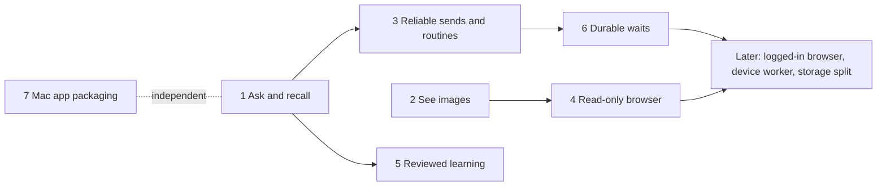

# Review of the OpenBot / Grok Bot improvement plan

Reviewed 27 October 2026 against the current source in this checkout. It covers the [improvement plan](studio-best-of-openbot-grok.md) and the two research notes. No live engine, account data or deployment was touched. The owner approved this order and the recommended defaults for every decision below on 27 October 2026.

## Short answer

The direction is right: bots that ask when they are stuck, find old decisions, see images and use a browser. Those are the gaps that stop real tasks today. Three things are wrong with the plan, though.

- **The order puts infrastructure first.** It starts with a large storage and durable-task rewrite (releases 2–3, sizes L and XL) before most of the user-visible gains. Those gains do not need it.
- **Some items are already built.** Release 0 is done, half of the questions work exists, and routines already have Run now and pause.
- **Some items would quietly change what Tupies is.** Turning a bot chat into a task queue, shared workspaces with resource locks, resuming after a restart, and a logged-in browser on the VPS are product decisions, not engineering steps.

The proposed order below ships the useful parts in small releases. It postpones the rewrites until a measured need appears.

## Corrections to the plan's baseline

| Plan says | Source shows |
| --- | --- |
| Releases A–C "await coordinated deployment" (also in both research notes) | Deployed to the Mac and the VPS together on 27 October 2026 at 20:15 CET (`PROJECT_CONTEXT.md`). Release 0 is done, apart from watching real long chats. |
| Questions need wiring "into engine/tool/API/UI" | Half built. `lib/questions.mjs` has the tool definition and validates questions and answers. `lib/dashboard.mjs` already shows `waiting_for_input` runs under **Needs you** and handles the `question.request` and `question.answered` events. Missing: the engine never registers or runs the tool, `control()` only accepts `stop` and `approval`, and the chat has no question card. |
| Storage is a scaling problem to fix second | The live `state.json` is about 0.95 MB. The roadmap measured a 22 MB state at about 18 ms per commit. It is not a bottleneck yet. |
| Image understanding is bundled with the browser (XL) | `sharp` is already a dependency, and every main provider accepts image input. Vision alone is size M and does not depend on durable tasks. |
| Resource claims stop "two bots editing related files" | Each bot has its own private workspace, so two bots cannot overwrite each other's files today. This only becomes a problem if shared workspaces are introduced. |
| Routines need "Run now, pause, history" | Run now (`POST /api/routines/{id}/run`) and pause (`enabled`) exist. A missed run catches up once on the next tick, and a busy bot defers it. History, time zones and calendar schedules are missing. |
| "Unknown outcome" is new | `unknown` is already a terminal run status (`lib/engine.mjs:13`). Interrupted tools are recorded with "do not assume its action executed". |
| Not mentioned | **Run history is lost.** `state.runs[botId]` keeps only the latest run, and each new task overwrites the previous run's events, usage and errors. Routine history, debugging and any benchmark need this. It is a small fix. |

## Item-by-item verdict

Legend: **Do** = really worth doing. **Have** = already built. **Partly** = partly built, finish it. **Changes the idea** = needs your decision. **Defer** = not needed now.

### Release 0 — validate A–C

| Item | Verdict | Note |
| --- | --- | --- |
| Deploy A–C to Mac and VPS | **Have** | Done on 27 October 2026. |
| Fixture: an old constraint survives compaction | **Do** | Fold it into Phase 1's tests rather than a separate release. |
| Watch real long chats, summary quality, cache hits | **Do** | Ongoing. Already on the roadmap. |

### Release 1 — questions and history retrieval

| Item | Verdict | Note |
| --- | --- | --- |
| Wire `ask_user` (answer, skip, wait, Stop) | **Do**, **Partly** | Best value for cost in the whole plan. |
| `session_search` / `session_read` | **Do** | This is your own context release D. It needs no storage change: a bounded scan of `state.messages` is cheap at the current size. |
| Separate secret-entry path | **Do**, later | Keep "never ask for secrets" in the tool for now; it is already in the description. |

### Release 2 — submissions and storage

| Item | Verdict | Note |
| --- | --- | --- |
| Client submission ID with dedupe and status lookup | **Do**, smaller | A busy bot already refuses a second task, so the real risk is a retry over a flaky phone connection after a fast finish. This is size S, not L. |
| Move transcripts out of `state.json` | **Defer** | Already on the roadmap. Do it when a measurement triggers it (for example state over about 10 MB or commits over about 10 ms). |
| Transactional indexed store (SQLite) | **Changes the idea** (architecture) | It reshapes sync, which maps state to documents, and `node:sqlite` is still experimental on Node 22. |

### Release 3 — durable tasks

| Item | Verdict | Note |
| --- | --- | --- |
| Keep a history of runs | **Do** | Missing today (see above). Size S. |
| Central lifecycle predicates | **Partly** | `isActive` and `TERMINAL` exist. Adding `waiting_for_input` keeps them sufficient. |
| Queued tasks; conversation separate from task attempts | **Changes the idea** | It turns "a teammate you chat with" into a job runner. |
| Checkpoints and resume after restart | **Changes the idea** | It reverses invariant 5, which says a restart interrupts work and never resumes it. |
| Durable event waits (question or approval survive a restart) | **Do**, later | Matters only after questions exist and long waits become common. |
| Read-only live event route for other devices | **Partly** | `GET /api/bots/{id}/events` and chat polling with ETag exist. Cross-engine progress mirroring is on the roadmap. |

### Release 4 — browser and vision

| Item | Verdict | Note |
| --- | --- | --- |
| Image understanding | **Do**, early | Unbundle it from the browser and ship it alone. |
| Read-only browser: render, screenshot, extract | **Do** | The biggest capability gain. It needs vision first. |
| Logged-in browser profiles, form submission, takeover | **Changes the idea** | The engine would hold your web sessions (cookies) on the VPS: a new trust boundary beyond sealed API keys. |

### Release 5 — teammates and routines

| Item | Verdict | Note |
| --- | --- | --- |
| Resource claims on shared workspace trees | **Defer** / **Changes the idea** | Workspaces are private, so this solves a problem you do not have unless you add shared workspaces. |
| Assignments with dependency graphs | **Defer** | It adds a project-management layer. Add an `expected_output` field to `delegate_task` instead. |
| Asynchronous teammate results | **Defer** | It needs durable waits. Today the parent's runtime limit already pauses while a teammate works. |
| Routines: time zone, daily or weekly at a time, one-time, history, explicit missed-run policy | **Do** | Run now and pause: **Have**. |

### Release 6 — device and learning

| Item | Verdict | Note |
| --- | --- | --- |
| Mac device worker; VPS bots get no Mac authority by default | **Do**, last | Already future work in the product intent. It needs the security roadmap items first (pairing ECDH, engine-bound device signatures, scoped device capabilities). |
| Bots propose memory or skill changes for your review (diff, source, undo) | **Do** | `skills_create` already needs exact approval but cannot edit. This fits the roadmap's reflection routine and background memory review. |
| Shared team-wide memory | **Changes the idea** (small) | Memory is per bot today. Start with proposals for the bot's own memory and skills. |

### Release 7 — standalone product

| Item | Verdict | Note |
| --- | --- | --- |
| Bundled Node, signed and notarized Mac app, TestFlight, push | **Do** | Already on the roadmap. It is an independent Apple track that can run at any time. |
| Setup that verifies the provider | **Partly** | The connection test ("Your provider is ready") exists. |
| Attention surface | **Have** | Dashboard **Needs you** and **Working now**. Questions will appear there once they are wired. |

### Across the plan

| Item | Verdict | Note |
| --- | --- | --- |
| Benchmark across all three products | **Partly** | Build a Tupies eval set: scripted fixtures plus about 8 real tasks, run before and after each phase. Running OpenBot and Grok Bot side by side is optional, done by you with your accounts. |
| No Full-access defaults; no Grok backend; no multiuser | **Have** | Consistent with the invariants. |

## Decisions that change the product idea

Each of these needs your choice before anyone builds it. The recommended default keeps Tupies as it is.

1. **Bot = one conversation, or a task queue?** Recommended: keep one conversation and one active task per bot. Only routines and teammate requests wait in a short line; your own messages never queue.
2. **Resume after a restart?** Recommended: keep "interrupt, never replay or resume" for actions. Later, only a pending question or approval with no action taken yet may survive a restart.
3. **Browser: where and logged in to what?** Recommended: start read-only and without logins, on the engine that runs the bot. Chromium is installed by an explicit setup step, never at runtime. Logged-in profiles and takeover come as a separate later decision.
4. **Shared workspaces and team memory?** Recommended: keep workspaces and memory private per bot. Bots propose changes to their own memory and skills, and you review them.
5. **A database?** Recommended: not now. When measurement triggers it, move to per-bot transcript files; keep `state.json` for configuration.
6. **What can `session_search` see?** Recommended: the Bot Chat searches the bot's own chat, rooms and routines, but not other people's Telegram chats. A Telegram chat searches only itself.

## Development plan

Each phase is a usable release with its own tests and docs updates. It follows the usual deploy procedure (check for active work, back up, update the Mac and the VPS together if sync changes). Sizes show scope, not dates.

### Phase 1 — Ask and recall (M)

**Status:** shipped to both engines on 27 October 2026 at 20:52 CET, after 466 tests and a browser check on a scratch engine. See `PROJECT_CONTEXT.md` and `docs/verification.md`.

- **Questions.** Register `ask_user` only for interactive Bot Chat tasks: not routines, delegated work, Telegram or autonomous room turns. Executing it sets `waiting_for_input` with `pending_controls:[{kind:'question',…}]` and a new `execution_generation`. Add a `control(botId,'answer',{runId,remoteRunId,request_id,execution_generation,answers|skip})` that uses `validateAnswer`. The answer returns to the model as data. Pause the runtime limit while waiting, as delegation does, bounded by `MAX_IDLE_MS`. Stop resolves the wait and cancels. A restart marks the task interrupted, as approvals are today.
- **Question card** in the chat and on the phone layout: choices, free text, Skip, Stop. The Dashboard needs no change.
- **History tools.** Add a new `lib/history.mjs` with two tools in the Memory group. `session_search` does bounded lexical search over the bot's display messages (reusing the `lib/brain.mjs` ranking where possible). It returns message ID, date, lane, role and snippet, plus a cursor and a count of left-out results. `session_read` takes a message ID plus bounded context before and after. The lane rules follow decision 6.
- **Run history.** On finish, append a compact record (ID, source, lane, status, timings, usage, error, artifacts) to a local per-bot ring of about 50. It never syncs. Show it in the bot profile's Overview.
- **Files:** `lib/engine.mjs`, `lib/questions.mjs`, `lib/agent-tools.mjs`, new `lib/history.mjs`, `server.mjs`, `public/app.js`, `public/mobile.css`, `docs/context.md`, `docs/capabilities.md`, `docs/api.md`.
- **Acceptance:** a scripted task asks, waits, takes the answer and continues. Skip gives no invented answer. A stale `request_id` or generation is refused. Stop while waiting ends the task and its children. A bot whose early constraint was summarized away finds it with `session_search` and cites the right message ID. Run history keeps earlier runs. Full suite, plus a browser check on a scratch engine.

### Phase 2 — See images (M)

**Status:** built and verified on 27 October 2026 (477 tests, browser check with a scratch provider that decoded the received image). Shipped to both engines at 22:34 UTC as part of the mobile + vision rollout, from an isolated release without notification or Phase 3 code. The capability rule adds the owner's per-connection setting and a known-family fallback. A refused image is retried once without images, so a family guess cannot break a task.

- Per-model image capability from provider metadata. Unknown means no images, matching how reasoning controls are handled.
- When admitted attachments include PNG, JPEG or WebP and the model supports images, send them as image parts. Resize with `sharp` to provider limits, apply aggregate limits, keep the rest as metadata.
- Retire "image vision is unavailable" only for capable models. Set `imageVision` in capabilities per bot.
- **Files:** `lib/providers.mjs` (OpenAI Responses, Anthropic, OpenRouter, xAI, compatible), `lib/engine.mjs` attachment admission, `docs/rich-chat.md`, `docs/capabilities.md`.
- **Acceptance:** a known screenshot fixture is described correctly with a scripted provider, plus one manual check with a real provider. An unsupported model gets the current text-only behavior with a clear note.

### Phase 3 — Reliable sends and better routines (M)

**Status:** built and verified on 27 October 2026 (557 tests, browser check of a lost send and the routine dialog). Shipped to both engines with Phase 4 on 28 October 2026. The message route is `POST /api/bots/{id}/messages`. Room messages are not covered yet.

- A `clientMessageId` on `POST /api/bots/{id}/run`. A small receipt map holds ID, payload digest and run ID. The same ID returns the original run; a different payload is refused. The browser reconciles on a network error before retrying.
- Routines: IANA time zone, "every N minutes", "daily or weekly at a time" and "once at". Per-routine history comes from Phase 1's run history. An explicit missed-run choice ("run once when back" or "skip"). A busy bot defers, as today.
- **Acceptance:** a double submit creates one run. Daylight-saving and downtime follow the chosen policy without duplicates. Only the home server schedules.

### Phase 4 — Read-only browser (L)

**Status:** built and verified on 28 October 2026 (574 tests, 6 of them against real Chrome, and a browser check on a scratch engine). Shipped to both engines on 28 October 2026, with Chromium on the VPS sandboxed under the service's hardening. No new dependency: Tupies drives an installed Chrome or Chromium over the DevTools pipe. Clicks are allowed for reading; there is still no typing. Screenshots are shown to vision models.

- A `browser` tool group behind engine permissions: open URL, current snapshot with revision-bound element references, screenshot (fed to Phase 2 vision), bounded text extraction, scroll and click for reading. No typing into forms or logins, and the same SSRF and egress rules as `http_fetch`.
- A worker process owned by the task that drains on Stop and task end, like LSP and background commands.
- Owner setup: install Chromium explicitly in **Settings**. It is not a runtime download.
- **Acceptance:** a deterministic local test site. Stale references are rejected. Stop kills the worker. Results are verified before they are claimed.

### Phase 5 — Reviewed learning (M), after Phase 1

**Status:** built and verified on 28 October 2026 (589 tests and a browser check on a scratch engine). Not deployed yet. `memory_set` stays direct when the owner asks; bots use `memory_propose` and `skills_propose` for inferred or unattended learning. Suggestions sync between engines. See `PROJECT_CONTEXT.md` and `docs/memory.md`.

- Bots propose changes to their own core memory and skills, including edits to existing skills, as a diff with source message IDs and a base revision. You review them in the bot profile (accept or reject). A stale proposal is refused, and every applied change has an undo record.
- This connects to the roadmap's reflection routine and background memory review.

### Phase 6 — Durable waits and asynchronous teammates (L), only after decisions 1 and 2

- Persist pending questions and approvals so a restart shows them as needing a fresh attempt, never a replay.
- Optional: teammate results delivered without holding the parent, plus a short wait line for routines and teammate requests.

### Phase 7 — Mac app packaging and notifications (L), an independent Apple track

- Bundled Node runtime, signed and notarized build, TestFlight, privacy-preserving push for approvals, questions and finished tasks. Already on the roadmap.

### Later, by trigger or decision

- **Storage split:** per-bot transcript files when measurement says so.
- **Logged-in browser** with takeover: decision 3.
- **Mac device worker:** after the security roadmap prerequisites.

### Eval set (start with Phase 1)

About 8 repeatable tasks on a disposable workspace:

1. Recall an old constraint after compaction.
2. Ask a question mid-task and continue.
3. Describe a screenshot.
4. Produce a verified spreadsheet.
5. Get a teammate's research.
6. Stop during a child task.
7. Restart near a tool call.
8. A routine after downtime.

Record verified completion, corrections, interruptions, time and usage. Run it before and after each phase.
