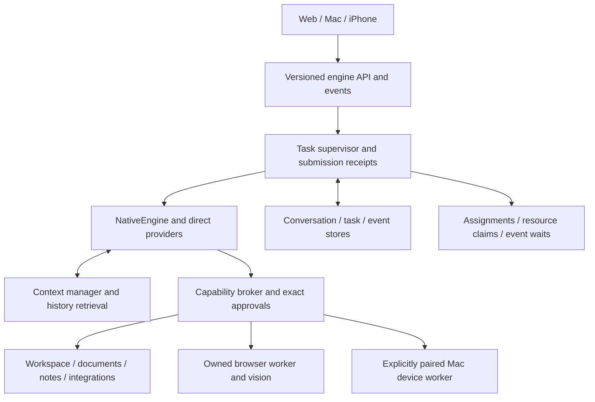

# Tupies improvement plan from OpenBot and Grok Bot

Prepared 27 October 2026 at the owner's request. This is a proposed implementation sequence, not completed work or authorization to deploy, migrate account data, or enable device actions. Evidence: [OpenBot 0.52.1](../research/openbot-0.52.1.md) and [Grok Bot 0.77.0](../research/grok-bot-0.77.0.md).

Build Tupies into an independent product that can finish useful work, recover context, ask for missing input, coordinate teammates and operate approved browser/device capabilities. Keep Tupies Engine, direct provider/subscription setup, persistent bots, verified documents, the Markdown brain, Apple-inspired interface and paired Mac/VPS/iPhone continuity.

The immediate baseline is releases A–C: window-based context, session lanes, structured summary compaction and owner controls, recorded with 448 tests for C and deployed to the Mac and the VPS together on 27 October 2026 at 20:15 CET. The owner approved a reordered sequence in the [plan review](studio-best-of-openbot-grok-review.md). Do not schedule a second summary-compaction implementation. Conversation search, engine-wired questions, browser automation, image understanding and durable task queues remain gaps.

## Patterns to adopt

| Source | Adopt | Adaptation for Tupies |
| --- | --- | --- |
| OpenBot | Durable tasks/events, command receipts, retrievable history, event waits, resource coordination, browser ownership/takeover | Implement around our own model/tool loop; preserve non-replay recovery and per-bot permissions |
| Grok Bot | Reconciled message submission, ordered live-state replicas, separate user-device capability, structured forms, reviewed shared learning | Serve through the owning Tupies engine and paired devices; no Grok service dependency |
| Tupies | Exact engine approvals, immutable active-run snapshots, verified outputs, named teammates, Markdown notes and trusted engine/app boundaries | Retain these contracts while replacing weak internal persistence/lifecycle components |

Competitor static code supports these design patterns. It does not establish superior reliability, backend semantics or benchmark outcomes.

## Target architecture

The module names below describe proposed contracts. They are not claims that these modules already exist.

- **Submission receipt:** owner/authenticated caller, `submissionId`, payload digest, session identity, task ID and admission outcome. The same identity with different content is rejected. Acceptance is separate from execution and completion.
- **Task supervisor:** `taskId`, `attemptId`, `parentTaskId`, `ownerEngineId`, immutable provider/model/capability snapshot, budgets, state, checkpoint and cancellation ownership.
- **Conversation store:** append/read/search, stable message/session IDs, compaction revisions, transcript/model-history separation and source-message provenance.
- **Task events:** version, task/attempt ID, generation and monotonic sequence, actual activity, bounded output previews, verified artifacts and control identities. A cursor permits reconnect without resubmission.
- **Capability broker:** typed input/output, enabled groups, exact permission decision, credential handoff, execution target, worker generation, request ID and cancellation/result semantics.
- **Collaboration coordinator:** permitted teammate, expected output, dependencies, resource claims and bounded completion delivery. A teammate's reply remains data, never authorization.

## Release sequence

Relative sizes indicate scope and uncertainty, not calendar estimates. Each release must deliver a usable workflow before broadening its surface.

### 0 Validate the completed context baseline

**Size S–M.** Establish task fixtures and confirm releases A–C against current source. Coordinate Mac/VPS deployment as an explicit later operational step because B changes sync schema. Check active work and preserve the full runtime tree before a restart; keep source and deployed versions visible in the handoff.

Acceptance: old constraints survive compaction; Summarize and New topic keep display history; model history and lane watermarks stay correct; provider overflow recovery never repeats a tool effect. Record actual model/provider differences and results. The 448-test record is a baseline to rerun when implementation changes, not a substitute for deployment checks.

### 1 Recover missing input and old decisions

**Size M; depends on 0.** Wire `lib/questions.mjs` into engine/tool/API/UI dispatch. Add bounded `session_search` and `session_read` over stored transcripts and summaries, with session scope, message IDs, cursors and explicit omitted-result counts. Preserve the current owner-DM and teammate lane choices.

Initial question controls should cover answer, skip, waiting state and Stop. Later typed forms can reuse this task-control contract. Secret entry must use a separate credential path; ordinary question answers never authorize effects.

Touch points: `lib/engine.mjs`, `lib/agent-tools.mjs`, `lib/questions.mjs`, `lib/api-native.mjs`, `server.mjs`, `public/app.js`, `lib/sessions.mjs` and the context docs. Reuse the existing question validation/generation logic.

Acceptance: a run asks a real question, releases unnecessary polling, accepts the matching authenticated response and continues. Skip produces no invented answer; stale/duplicate responses cannot affect another task. A bot retrieves a decision outside its active summary/window and cites the correct stored message. Stop while waiting cancels the request and children.

### 2 Establish reliable submissions and scalable storage

**Size L; depends on stable IDs from 1.** Introduce store seams before moving data. Separate growing transcripts/events/attempts from small bot/provider configuration. Prefer a transactional indexed store after verifying the implementation on Node 22.16+, bundled Mac, VPS and container targets. OpenBot's Node 24 database implementation is a reference, not a dependency choice for our verified Node 22 baseline.

Add stable submission identities and an authenticated status lookup. Persist admission and its receipt together; reconcile an uncertain client send before retry. Task events and receipts must exclude credentials. An event log/receipt can deduplicate our state mutation; it cannot make a remote action exactly-once.

Touch points: new storage contracts/adapters, `lib/store.mjs`, engine admission, native API, browser client submission, Apple session transport, `lib/sync/docs.mjs` and migration utilities. Preserve existing public IDs and sealed credentials.

Acceptance: retrying the same submission creates one admitted task; a conflicting payload is refused; acceptance never appears as completion. Reading/committing one bot's new turn does not rewrite every unrelated transcript. Migration validates counts, IDs, content digests, compaction records, attachments/artifacts and references. Failed import leaves the existing workspace usable.

### 3 Make long work durable and inspectable

**Size XL; depends on 2.** Add durable task/attempt queues, checkpoints, event waits and explicit unknown outcomes. Keep one execution owner. Separate a user conversation from task attempts; retain current bot identity and model-history semantics deliberately instead of silently changing who shares a lane.

Centralize lifecycle predicates used by admission, sync presence, dashboard, rooms and Stop. Include waiting for a delegate, input, approval or external event. Live progress should come from a separately authenticated read-only event route on the owning engine. Do not sync runs, approvals, passwords or activity to implement it.

A suspended wait should release model/process resources where possible. Store the wait condition and expiry, then wake exactly the matching task. Each resumed attempt keeps its original execution snapshots or requires an explicit new attempt boundary. Budgets remain bounded; raising step/runtime limits alone is not this feature.

Acceptance: restart between committed steps preserves task identity and artifacts. An action with an uncertain external result becomes unknown/requires reconciliation and is never replayed automatically. Reconnect resumes event display without another run. Cancellation drains children, workers and processes; no unfinished task is marked successful. Only the home server schedules routines/channels.

### 4 Add browser work and image understanding

**Size XL.** Design/prototype can run alongside 2–3 using disposable fixtures; production lifecycle depends on 3. Add provider-confirmed image inputs and an owned browser worker with per-bot profiles, current snapshots, revision-bound targets, screenshots, bounded extraction, downloads and user takeover.

Start with reading/searching and a deterministic test site, then approved form submissions and file workflows. Keep browser authentication outside model-visible arguments through an explicit human/credential handoff. Browser network access needs its own session/SSRF/egress boundary; carrying cookies into a session is a new capability, not ordinary public `http_fetch`.

Touch points: provider input/result adapters, attachment admission, agent tools, capability protocol, browser worker supervisor, artifact verification and client live view. The existing engine permissions and exact approval identities remain authoritative. Integration actions, deletes, scripts and terminal remain approval gated.

Acceptance: understand a known attached screenshot; complete an authenticated fixture workflow; reject stale element references; honor takeover and revocation; Stop terminates owned work. Verify resulting state/files before completion. Exercise actual browser/device paths in addition to protocol fixtures.

### 5 Coordinate teammates and richer routines

**Size L; depends on 3 and worker/resource identities from 4.** Add assignments with expected outputs, allowed scope, dependencies and resource claims. Allow bounded asynchronous results without holding a parent turn merely to poll. Serialize overlapping writable workspace trees, the same browser session and the same device/app target. Keep depth/cycle/count/budget limits and each participant's permissions.

Expand routines with timezone-aware calendar/one-time schedules, Run now, pause, history and explicit missed-run/quota policies. Event waits can connect routines and jobs without an always-running model turn. Persist attempts and distinguish a missed schedule from an uncertain action.

Acceptance: two bots editing related files do not silently overwrite one another; dependency cycles and unauthorized recipients are refused; cancellation reaches queued/active children. A shared browser/app cannot be driven concurrently by conflicting tasks. Downtime and timezone transitions follow the selected policy without duplicate effects.

### 6 Add explicit Mac capabilities and reviewed learning

**Two independent tracks, sizes XL and M.** The device track depends on 3–5 and completion of the existing pairing/signature/pinning prerequisites in the security roadmap. The knowledge track can follow 1–2.

For devices, add a separately paired worker with capability hello, device identity, OS permission/readiness, current policy revision, app/browser target, request dedupe and generation. A VPS bot starts with no personal-device authority. Begin with explicitly selected app observations and approved actions. Terminal, credential stores and system settings retain separate boundaries; general remote shell is not a substitute for a device protocol. iOS can expose only actions its platform permits.

For knowledge, let bots propose shared core-memory/skill changes with source-message provenance, a diff, revision and owner review. Private note tools keep their current policy. Apply only to the reviewed revision; reject stale approval and keep an audit/undo record. Model-written knowledge and skills remain untrusted task content.

Acceptance: revocation/policy changes remove capabilities immediately; app identity/OS consent is checked; loss of the worker drains work; cancellation distinguishes not-run from may-have-run. Knowledge proposals show their origin; rejection changes nothing; stale decisions cannot overwrite newer instructions or expand tools.

### 7 Deliver an approachable standalone product

**Size L; start design early, ship on stable contracts.** Bundle the Mac runtime, sign/notarize distribution, and retain the Apple shell's engine switching. Setup should connect a real provider and verify readiness before specialist settings. Extend the existing Dashboard into a trustworthy attention surface for working, queued, needs-input, approval, completed and failed states; avoid a duplicate status system.

Show the execution target clearly when it matters: bot workspace/browser, Mac app, or home server. Add authenticated remote progress through the event route, and later privacy-preserving notifications. Keep Roki's accepted portrait/mascot roles and current glass direction; this plan does not restart visual design work.

Acceptance: a fresh Mac needs no developer shell or external Codex/Hermes installation; an iPhone can see and respond to its engine's work; reconnect does not duplicate submissions; real readiness/failure states are understandable. Verify the physical iPhone and supported desktop browsers.

## Storage and rollout safeguards

Implement a side-by-side migration under the existing single-owner lifecycle. Quiesce work, preserve state/vault/skills/workspaces together, export deterministic records with current IDs, build the new store separately, validate counts/digests/relationships, then atomically switch a versioned storage manifest. Keep the old snapshot read-only.

Before new writes, rollback can select the old store. After new writes, rollback must export/reconcile them; silently restoring a stale snapshot would lose work. Do not run old/new schedulers against the same account or copies of its live data. Sync schema changes need coordinated deployment or negotiated compatibility. Fix privacy/credential exclusions before introducing immutable event storage.

Each engine/provider/tool/persistence/lifecycle implementation change requires the full regression suite, syntax/build checks as appropriate and deterministic fixtures. Visible workflow changes also require an actual browser. Release with source, built assets, runtime/dependency notices and migrations; exclude account data and investigation outputs.

## What this plan deliberately preserves

Permissions stay in code. Imported prompts/skills, memory, documents, web pages, teammate messages, structured forms and automatic reviewers cannot grant access. Preserve authentication, Origin/Host/CSRF, credential-destination and private-path checks; immutable active-run snapshots; attachment admission at Send; verified artifact cards; sanitized rich output; cancellation ownership and non-replay restart behavior.

Do not import OpenBot's broad Full-access defaults, depend on Grok's backend, loosen rich-chat execution restrictions to imitate Canvas, or expand to multiuser sharing before the underlying authorization model exists. More capable work should result from scoped tools and reliable lifecycle handling.

## Measures for deciding what is better

Maintain one disposable benchmark set across the three products: old-constraint recall after compaction, clarification and continuation, screenshot understanding, an authenticated web action, a verified document/spreadsheet, related edits by two bots, Stop during child/device work, restart near an external effect, and a routine after downtime.

Record model/runtime and permission differences, verified completion, corrections, appropriate user interruptions, latency, available usage/cost, artifact correctness, recovered constraints and ambiguous outcomes. Compare repeatable tasks rather than feature counts. A release succeeds when it improves a measured workflow without weakening the preserved contracts.

The first implementation slice should be release 1: real questions plus bounded conversation retrieval on top of C. Storage/submission design and a disposable browser prototype can proceed in parallel. Deployment, data migration and native actions remain explicit operational milestones.
