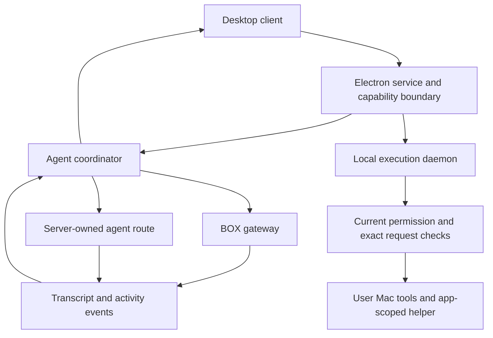

# Grok Bot architecture and comparison with Tupies

Reviewed 27 October 2026 from the supplied Grok Bot 0.77.0 disk image. The combined implementation proposal is in [Tupies improvement plan](../plans/studio-best-of-openbot-grok.md). The [OpenBot investigation](openbot-0.52.1.md) supplies the other product reference.

Grok Bot's clearest lessons are a separate boundary for the user's computer, reliable submission and live-state delivery, structured questions/forms, and reviewable shared knowledge. OpenBot adds complementary examples of durable task coordination and retrievable history. Tupies can adopt these patterns while retaining its own direct-provider engine and self-hosted Mac/VPS architecture.

Tupies's baseline has advanced since the OpenBot review: releases A–C, including structured summary compaction and Summarize/New topic controls, are implemented and were deployed to both engines on 27 October 2026 at 20:15 CET. The persistent handoff records 448 tests for C. Those results are existing evidence, not tests rerun for this investigation.

## Execution ownership

The package contains an Electron desktop app, a separate node agent coordinator, and a local execution daemon. Their responsibilities are different:

The app obtains a BOX gateway through `ensureSandBox` and uses the returned gateway and VNC routes. It also supports an explicit host-gateway override. The coordinator distinguishes BOX agents from a server-owned route labelled `temporal`. Those labels establish client routing, not the backend workflow implementation or where every possible BOX runs.

The scoped send path calls `sendGrokBotUserMessage` with a stable client nonce as its message ID. It handles accepted BOX, accepted Temporal, duplicate and refused responses. The coordinator's BOX path posts to the resolved gateway's `/sendPrompt` endpoint.

The inspected package does not expose a complete reasoning/model/tool loop comparable to Tupies's `NativeEngine`. The local daemon executes requested host tools; its name does not make it the inference engine. Backend context policies, model routing, database transactions and task-recovery algorithms remain outside this package.

Evidence: G2/G3; A:51945, A:52113, A:52119, A:58403, A:61948; C:34070, C:35125, C:36351; D:63966, D:88475. Citation aliases and original-source mapping are below.

## Reliability patterns worth adopting

### Reconcile acceptance before retrying

Grok Bot distinguishes message acceptance from run completion. After an ambiguous service send failure, `Put` checks `getGrokBotSendStatus` before deciding whether to resend. The gateway adapter retries only after a pre-dispatch failure or established endpoint deduplication, with a client nonce; it aborts an uncertain retry if the gateway endpoint changes.

This is a strong fit for Tupies's cross-device clients. A reconnect should resolve the original submission identity, rather than create a second task. The implementation must keep accepted, queued, running, waiting, completed, failed, interrupted and unknown outcomes distinct. These client checks do not prove exactly-once external actions in Grok's backend.

Evidence: A:61948, A:62079; C:34070.

### Replicate display state independently of model context

The coordinator's transcript subsystem tracks agent/session generations, ordered update sequences, partial body hydration, retries and source fallback. The Electron app can restart a failed coordinator process with backoff and new message ports.

These mechanisms provide useful examples for responsive clients. Transcript display windows do not establish the model's context limit, memory recall or compaction algorithm. Restarting this client coordinator also does not establish replay of backend actions.

For Tupies, a versioned event stream from the owning engine can support Mac/iPhone reconnection and accurate attention states. Keep live runs and approvals outside workspace sync, as required by the existing sync contract.

Evidence: C:31194, C:36351; A:58442. Tupies: `lib/sync/docs.mjs`, `lib/sync/index.mjs`.

## Separate the bot environment from the user's computer

Grok Bot's local daemon has an explicit local-tool permission with `ask` as its default, choices for always/never, account-scoped settings and a permission ceiling. Per-request mediation combines current policy, server-authoritative authorization where applicable, scoped standing grants and exact approval/target matching. This establishes mediation code, not an audit of every end-to-end authorization route.

The computer-use router requires an app target with a PID and target identity. It explicitly refuses terminal, script-running, password, System Settings and agent-hosting apps. A selected app still needs an app-use decision. This is an application-level restriction; it is not proof of OS sandbox containment.

The helper manager serializes calls per conversation, owns helper sessions and screenshot lifecycle, checks macOS Accessibility/Screen Recording readiness, and keeps queued work alive. Its cancellation results distinguish a request that may already have reached the computer from refusal before an action ran. The local bridge refreshes advertised capabilities after policy changes, bounds in-flight/backlog work, deduplicates acknowledgements and drains during close.

Tupies should adapt this separation. An engine's workspace tools and a Mac's personal-device tools need different capabilities. Linking a Mac to a VPS must not automatically give the VPS's bots control over the Mac. Prefer scoped browser/app targets, explicit device readiness and revocation, and honest uncertain-action outcomes. Retain exact engine approval identities and separate terminal authority.

Evidence: D:34798, D:35472, D:36715, D:36765, D:64262, D:64308, D:87781, D:87908, D:88027, D:88517.

## Product workflows worth adapting

| Pattern | Observed shipped implementation | Tupies lesson |
| --- | --- | --- |
| Structured interaction | Actual routes submit or dismiss forms, answer credential requests and resolve local/connector approvals. Form rendering includes validation, secret fields, destination-host display and pending/error states. | Wire the existing question subsystem first. Keep an answer, a credential handoff and an approval as separate operations. |
| Reviewable shared knowledge | Memory/folder-memory/skill proposals include status, proposer/reviewer and timestamps; the UI offers Review, accept and reject. The app calls list/resolve service operations. | Add provenance and review for shared knowledge changes. Private notes can retain their current policy. Backend review enforcement in Grok is not visible. |
| Connector policies | Client policy mappings support per-tool settings and separate reads/writes. Unknown permission values fall back to requiring approval. | Improve visibility of connector scope and readiness. Do not treat a connector's self-description as authorization or import automatic review as Tupies's permission authority. |
| Inspectable automation | Client schemas include calendar recurrence and IANA timezones. Routes list, toggle, remove and invoke routines; the UI shows triggers, prompts, runs and pause/test controls. | Expand Tupies routines with clear triggers, timezone, Run now and run history. Backend missed-run/recovery guarantees are unknown from this package. |
| Computer readiness and takeover | Browser/computer preview UI distinguishes asleep, waking and ready. The app exposes BOX VNC/handoff boundaries. | Make the active execution environment and human takeover visible; show observed readiness rather than a generic spinner. |
| Knowledge and files | Dedicated bot views search/manage skills and files; memory lists show dates and capped-result states. | Build on Tupies's existing Brain/Memory/Files views with provenance and honest pagination. |

Evidence: A:61000, A:61048, A:61993, A:62041, A:62135, A:63181, A:63287, A:63326, A:75848; renderer form:517/564/626/786, knowledge:275/308/367, automation:175/215, preview:239/318.

The package also routes creation of rooms with both bot and human members. Tupies currently has a single-owner authentication model, so human-team sharing is a separate product/security expansion rather than a prerequisite for better bot collaboration. Evidence: A:58664.

Onboarding coordinates role/tools/computer setup and shows readiness/error states. Illustrated demonstrations do not establish live task success. Generated interactive canvases use a distinct execution surface with iframe policies. Tupies should preserve sanitized rich chat and evaluate any future executable artifact surface separately. Evidence: renderer onboarding:378/554; A:31278, A:54620, A:54928.

## Context and reset claims need a narrower boundary

The packaged reset confirmation says the conversation history starts over while memory, files, routines and settings remain. The renderer confirms the action and calls `startFreshConversation`; the main process forwards to `startFreshGrokBotConversation` on the service.

This establishes the advertised fresh-conversation behavior. It does not establish physical deletion of old transcripts, backend retention or recovery, nor the model's compaction strategy. Tupies's earlier note that Grok reset "erases" chat was too broad and is corrected alongside this report.

Tupies C's own behavior is observable in our source: a new topic stores a background summary, retains the complete display transcript, and continues the same conversation. History retrieval remains the next missing piece.

Evidence: A:61973; original renderer `index.eager-app-pljxi3Ue.js`, UTF-16 offset 3665141, localization IDs `T1rcxH`/`8agLZa`; `index.eager-common-B2THygQN.js`, offset 41284. Tupies: `lib/compaction.mjs`, `docs/context.md`.

## Comparison with OpenBot and Tupies

| Area | Grok Bot 0.77 | OpenBot 0.52.1 | Current Tupies source |
| --- | --- | --- | --- |
| Engine ownership | Desktop/coordinator route to gateway/service execution; backend loop unavailable | Own orchestration around Codex, Claude SDK, ACP and other harnesses | Own Node model/tool loop and direct provider protocols |
| Durable work | Acceptance reconciliation and client transport/lifecycle visible; backend storage/recovery unknown | SQLite coordination, task lanes, command receipts and event waits visible | Atomic whole-state persistence and bounded runs; durable task history/queues remain future work |
| Context | Transcript replica and fresh-conversation UI visible; backend compaction unknown | Runtime-specific compaction, bounded excerpt handoff, history tools | Window-based budgets, structured summaries and topic controls implemented; history search absent |
| Device access | Separate local daemon, scoped policy, app targets and helper lifecycle | Browser host and native driver lifecycle | Private workspaces and approved host processes; browser/vision/device worker still future work |
| Team learning | Reviewable shared knowledge proposals and service routes | Essential/searchable memory and revision checks | Core facts, Markdown brain and recall; shared review workflow absent |
| Interaction | Forms, credentials and approvals have separate client paths | Working questions/forms, takeover and attention coordination | Approvals work; question class exists but is unwired |
| Product fit | Service-backed bot workspace with local capabilities | Broad desktop workspace across runtimes | Independent self-hosted bots-first Mac/VPS/iPhone product |

The strongest combination is OpenBot's task/history/resource architecture, Grok Bot's device/submission/interaction boundaries, and Tupies's independent execution, exact permissions, verified outputs and paired app continuity. This comparison does not rank live task quality.

## Evidence and coverage

| ID | Evidence | Boundary |
| --- | --- | --- |
| G1 | REA package inspection `ev_e06b0d05862755a1a153213830f636a07358fd949086ba9c798adb57da06a965` | Complete inventory within tool scope: 1,671 occurrences; 11 native companion integrity contradictions retained explicitly. |
| G2 | REA JavaScript analysis `ev_c3e356b3becb0f814c60016757ed6a6754d75dbbd5843a8718748fd52aa71d98` | Selected package metadata and six core JavaScript files, no parse failures. 704 inventoried relevant files unselected; application/semantic graphs partial with bounded semantic retention. |
| G3 | Focused static inspection of selected shipped text | Core and renderer paths/functions above; esbuild formatting was inert transformation, not target execution. Source-map-derived anchors preserve locations in original bytes. |
| O1 | [Prior OpenBot report](openbot-0.52.1.md) | Reused fixed-package evidence; its original Tupies baseline predates Release C. |
| S1 | Current Tupies source and handoff | C is implemented/undeployed; live deployment status and account behavior were not inspected. |

Source aliases refer to esbuild-formatted files: A = `dist/electron-main/main-app.cjs`, C = `dist/node-agent-coordinator/main.cjs`, D = `dist/local-exec-daemon/main.cjs`. Renderer aliases refer to the correspondingly named `chunk-inline-user-form`, `chunk-bot-manage-knowledge`, `chunk-automation-detail-panel`, `chunk-computer-screen-preview` and `chunk-onboarding-flow` assets. `output/research/grok-bot-0.77.0/source-anchors.json` records exact hashed filenames, formatted lines, original lines/columns and UTF-16 offsets for 50 anchors. Formatting used repository esbuild 0.28.2 with external source maps.

DMG SHA-256: `8a2ae1a6263e24d52a647c9da228af0a72c425c476445d3b23bf8575389fe5e8`.

ASAR SHA-256: `adb7b74305dc63633a596df7c477210a2a4a88d49871ac91ab7d2f55c2fe973a`.

The 11 mismatches concern unpacked native companions. Post-packaging signing/stripping can cause such mismatches; their cause and authenticity were not established. Analysis continued under explicit record-and-continue policy, preserving those bytes as observed-untrusted. No native companion correctness or integrity assurance follows from the JavaScript findings.

Evidence summaries, the compressed complete retained ledger, selected-file hashes, original-source anchors and the Tupies source baseline hashes are in `output/research/grok-bot-0.77.0/`. These are research outputs, excluded from application release assets. Retaining a complete ledger does not make the semantic graph complete.

| Question | Status |
| --- | --- |
| Desktop/coordinator/local execution boundaries | Answered from packaged client code |
| User-device policy and helper lifecycle design | Answered statically; native helper and end-to-end enforcement unverified |
| Questions, team knowledge, connectors and routine UI paths | Answered at client implementation level |
| Service model loop, context policy, storage and task recovery | Unresolved; backend implementation absent |
| Live task quality, performance and preference | Unresolved; controlled runtime comparison required |
| Combined Tupies direction and implementable release sequence | Proposed in the linked improvement plan |

The disk image was mounted read-only and unmounted after source acquisition. No Grok Bot application/provider runtime was launched, no user account data was read, and target prompts/skills were treated as untrusted data. This investigation changes documentation and planning only.
