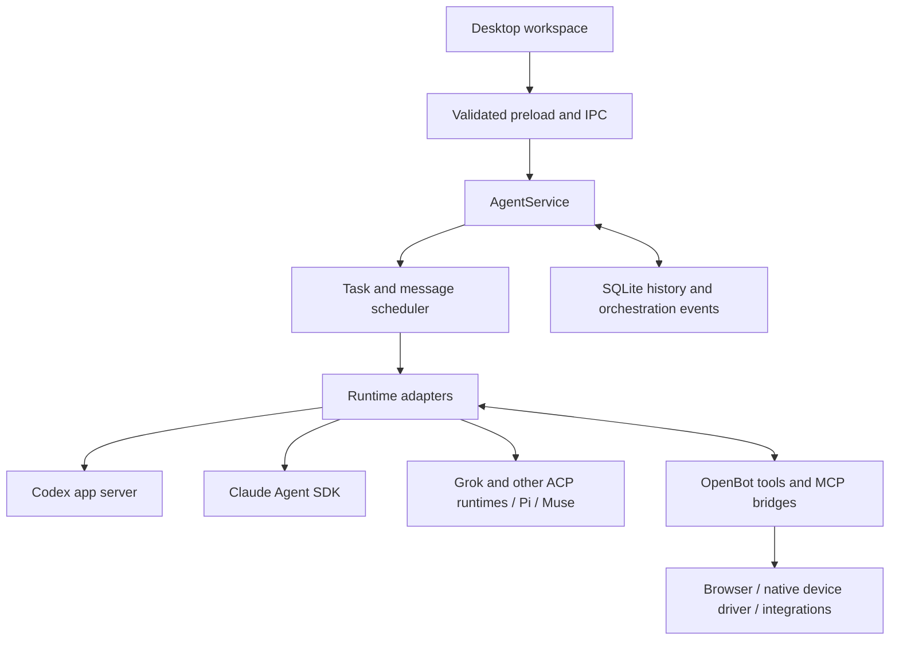

# OpenBot architecture and lessons for Tupies

Reviewed 27 October 2026. Target: the supplied OpenBot 0.52.1 Apple Silicon disk image. Tupies comparison: the current checkout, including context releases A and B that are implemented but await coordinated deployment. Hermes Agent comparison: current official upstream documentation and source, rather than the older commit recorded in the initial Tupies research.

Baseline update: Tupies subsequently implemented Release C summary compaction and Summarize/New topic controls, and releases A–C were deployed to both engines on 27 October 2026 at 20:15 CET. Statements below about Tupies lacking semantic summaries describe the earlier A–B baseline. Use the [combined improvement plan](../plans/studio-best-of-openbot-grok.md) for the current A–C baseline and remaining work; OpenBot package findings remain unchanged.

OpenBot's most useful lesson is the combination of capable agent runtimes with a durable desktop workspace: authenticated browser actions, tasks, recoverable history, structured questions, connectors and clear attention states. Tupies should retain independent execution ownership and replace its weaker context, task and capability subsystems behind that boundary. Reproducing OpenBot's full runtime strategy would introduce external agent harness dependencies that conflict with Tupies's current product requirement.

This is a static architecture comparison and a proposed engineering direction. Task success rates, live recovery and the reasons people enjoy OpenBot remain unmeasured.

## How OpenBot executes work

The packaged application uses Electron, a renderer built with Solid, a preload bridge, and a substantial backend coordinator. Its bundle retains source-section names, allowing focused inspection of the actual shipped implementation.

The central flow is:

The runtime distinction is important:

| Runtime | Observed integration in the shipped bundle |
| --- | --- |
| Codex | `CodexAppServerClient` spawns the resolved executable with `app-server --listen stdio://` and exchanges protocol messages. |
| Claude | `ClaudeAgentClient` creates a Claude Agent SDK query with the `claude_code` prompt preset, native tools, persisted/resumed sessions, MCP configuration and permission hooks. |
| Grok | `GrokAgentClient` extends the ACP client and launches `grok --no-auto-update agent stdio`. |
| Other providers | Driver registrations include ACP agents, Pi-backed key providers and a Muse native-session adapter. Behavior and compaction support vary by runtime. |

OpenBot owns significant orchestration. `AgentService` composes task delivery, mailbox, memories, provider management, routines, questions/approvals, compaction and recovery. `DrainScheduler` selects the correct conversation lane, adds a bounded handoff when needed, submits `turn/start`, and reconciles provider events. The selected harness owns the underlying model/tool loop. The analyzed path does not establish one OpenBot-owned direct-inference loop equivalent to Tupies's `NativeEngine`.

Evidence: E2; bundle `out/main/index.js:143279`, `:165414`, `:171549`, `:173718`, `:173982`, `:175125`, `:176005`, `:188780`.

## What is worth adopting

### Real browser and device capabilities

OpenBot implements persistent browser profiles/tabs, semantic snapshots, revision-bound element references, CDP input actions, screenshots, uploads/downloads and human takeover. `BrowserHost` owns the actual Electron browser partitions and operations; these are more than advertised tool names. Browser views enable sandbox/context isolation and disable Node integration. Secret-entry and takeover routes are separated from ordinary browser actions.

Its native computer-use runtime manages a bundled driver through a private local transport, tracks parent liveness and OS permissions, and exposes tools only when the driver is ready. This is a useful model for Tupies's planned device worker. Static inspection establishes the plumbing, not successful operation on arbitrary websites or devices.

Tupies currently fetches public web content and calls configured APIs. It has no browser automation, image understanding or OCR. That prevents whole classes of useful tasks regardless of model quality. A browser worker plus verified vision support is the largest capability expansion suggested by this comparison.

Evidence: E2 and focused bundle inspection at `:143801`, `:143953`, `:166955`, `:192034`, `:196175`, `:196270`, `:196347`, `:215520`, `:215783`. Tupies: `lib/engine.mjs:123`, `:166`; `docs/capabilities.md`.

### Recoverable context and searchable history

OpenBot tracks context usage and coordinates provider-specific compaction. Its common budget controller uses an 80% trigger where applicable; adapters also report or defer to native runtime behavior. Compaction holds the affected conversation lane rather than treating it as unrelated background activity.

When changing or rotating provider sessions, OpenBot assembles at most 32,000 characters of recent messages, older excerpts and captured work steps. This packet is explicitly incomplete; it is not a semantic summary. `history_search` and `history_read` let the model retrieve omitted detail. Search is a bounded case-insensitive substring scan, not vector search.

OpenBot also separates essential memory from searchable memory. Essential memory has an 8,192-byte serialized budget; searchable entries use SQLite FTS5. Memory operations apply revisions, ownership checks, staged changes and deduplication. This does not prove automatic consolidation after every task.

Tupies's current source already improves model-window budgets, tool-output trimming, prompt caching and session lanes. Those releases await deployment. Its remaining weakness is continuity after text leaves the active window: no semantic compaction handoff or conversation-search tool. Its Markdown brain already provides a useful editable knowledge vault and lexical recall.

Evidence: E2; bundle `:144688`, `:148258`, `:148272`, `:148819`, `:153037`, `:171805`, `:181409`. Tupies: `lib/context-budget.mjs:42`, `lib/engine.mjs:56`, `lib/brain.mjs:232`, `lib/sessions.mjs:18`, `docs/context.md`, `PROJECT_CONTEXT.md`.

### Durable tasks and waits

OpenBot stores history and coordination state in `openbot.db`. `DatabaseCore` enables SQLite WAL, foreign keys and migrations. A transaction appends orchestration events, updates projections and stores a command receipt. A repeated command ID can return its previously recorded result.

Tasks have separate conversation lanes, queue states, progress and outcomes. Concurrency accounts for provider support, per-agent limits, memory pressure and machine capacity. Event waits persist the wake request and release the current turn; a later event reactivates the work. Schedules include calendar and one-time choices, plus missed-run and usage-limit policies.

These mechanisms are stronger foundations for sustained work than increasing a timeout. They do not make external side effects exactly-once: command receipts cover the transaction they record, and a crash around a remote action still needs explicit reconciliation.

Tupies has honest stop/restart behavior, real child runs, task-owned processes and bounded execution. It currently admits one active run per bot and atomically rewrites one growing `state.json`. The normal run has 20 model steps, 60 tool calls and a five-minute runtime budget. Preserve its failure semantics while moving towards durable tasks, explicit checkpoints and suspension without polling.

Evidence: E2; bundle `:145602`, `:146065`, `:146232`, `:155277`, `:155349`, `:165023`. Tupies: `lib/engine.mjs:142`, `:307`, `:377`, `:472`, `:545`; `lib/store.mjs:64`.

### Structured collaboration and human input

OpenBot channel assignments include expected results, source messages, dependencies and resource reservations. Its coordinator validates membership and dependency cycles, bounds automatic assignments, and waits when work would conflict over a browser or overlapping workspace paths.

Its question tools reach an actual pending-response path. Interactive forms and confirmation blocks return answers to the waiting task, while provider approval remains a separate authority. Secure API-key collection can keep values outside model context. Connector configuration also has credential-aware handoffs and deliberate installation boundaries.

Tupies already delegates to real persistent teammates with their own model/tool snapshots, depth limits and cancellation. It would benefit from explicit task ownership, conflict coordination and asynchronous result delivery. Wiring its existing `lib/questions.mjs` into the engine is a smaller, useful first step.

Evidence: E2 and focused bundle inspection at `:146320`, `:147019`, `:147076`, `:147649`, `:150357`, `:167007`, `:186405`, `:187243`, `:187637`, `:301008`. Tupies: `lib/engine.mjs:443`, `lib/questions.mjs:8`, `docs/roadmap.md`.

### Setup and attention

OpenBot's first-run renderer narrows setup to a short provider/plan/computer sequence, checks real provider connection state, and can prepare a runtime while the person continues setup. Its attention coordinator combines active work, queues, questions, approvals, errors and unread replies across servers. Browser live views and takeover are integrated into work state.

These are plausible contributors to a feeling of competence and ease. Actual preference requires user observation. Tupies can adopt clear readiness and attention states while preserving its bots-first navigation, Apple shell and visual identity.

Evidence: selected renderer `FirstRunFlow-DyA3Wqjk.js:359`, `:525`; main bundle `:255712`. Renderer inspection supplements E2's selected-source graph; those renderer files were not included in its AST selection.

## An important permissions difference

OpenBot's packaged defaults select Full access, enable computer use unless disabled, and enable approval automation. Automatic approval still depends on the current standing grant; workspace-limited agents and tools marked to always ask have separate paths.

Fewer interruptions may contribute to perceived autonomy, but this comparison is not a security audit. Tupies's engine-enforced permissions, exact approval identities, private paths and credential-destination checks are valuable contracts. Improve autonomy within them. Browser/device actions need declared capabilities and engine approval for effects. Terminal, scripts, deletes and integration actions retain their existing approval requirements. A model's form, teammate message or imported skill cannot create authority.

Evidence: bundle `:1983`, `:1989`, `:2390`, `:150288`, `:150357`; Tupies `lib/agent-tools.mjs:94`, `:239`, `lib/engine.mjs:427`, `:499` and repository invariants.

## Comparison with Hermes Agent

Current Hermes Agent is a substantial Python harness with its own model/tool loop. It provides a pluggable context engine and summarizing compression. Current focused documentation describes compaction under one stable session ID with archived material kept available; older general descriptions of session rotation should not override that specific behavior. See [context compression](https://hermes-agent.nousresearch.com/docs/developer-guide/context-compression-and-caching) and [conversation-loop source](https://github.com/NousResearch/hermes-agent/blob/main/agent/conversation_loop.py).

Hermes stores sessions and full tool history in SQLite with FTS5, supports resume, and keeps accepted work owned by the gateway when clients disconnect. A gateway crash remains a different event with ambiguous work marked unknown. See [sessions](https://hermes-agent.nousresearch.com/docs/user-guide/sessions).

Its browser can execute model-written Python against a CDP harness, use packaged local Chromium and inspect screenshots. Its tool availability reflects the Python/terminal trust boundary. See [browser automation](https://hermes-agent.nousresearch.com/docs/user-guide/features/browser).

Hermes also offers background subagent delivery and more developed scheduled work. Its temporary isolated children differ from Tupies's persistent named teammates. See [delegation](https://hermes-agent.nousresearch.com/docs/user-guide/features/delegation) and [scheduled tasks](https://hermes-agent.nousresearch.com/docs/user-guide/features/cron).

| Area | OpenBot 0.52.1 | Current Hermes Agent | Current Tupies source |
| --- | --- | --- | --- |
| Execution ownership | Owns coordination around multiple agent harnesses | Own Python harness; additional runtime options exist | Own Node harness and direct provider protocols |
| Browser work | Integrated browser host, snapshots, actions and takeover | CDP/Python browser harness | Public HTTP and configured API tools |
| Context recovery | Runtime compaction, excerpt handoff, history tools | Summarizing compaction and searchable sessions | Window-aware trimming; summaries and history search remain future work |
| Durable work | Database tasks, queues, event waits, calendar schedules | Gateway sessions, background delegation, richer jobs | Bounded runs and interval routines; whole-state persistence |
| Collaboration | Persistent agents plus tasks, assignments and resource coordination | Isolated child agents and asynchronous results | Persistent teammates, real bounded child runs and rooms |
| Product direction | Broad multi-runtime desktop workspace | Broad agent framework and gateway | Standalone bots-first Mac/VPS/iPhone product |

Tupies's distinctive assets are execution and permission ownership, verified document artifacts, persistent bot identities, compatible skills and paired engine/app continuity. Matching either competitor's breadth independently still requires substantial engineering. Architecture alone cannot establish superior task quality.

## Proposed Tupies direction

Keep `NativeEngine` responsible for the direct-provider model/tool loop. Separate the surrounding responsibilities into clear contracts that can be improved independently:

1. **Task supervisor:** durable task/attempt IDs, queue admission, checkpoints, questions, cancellation and event-driven suspension. Resume from committed state; reconcile uncertain external actions before retrying.
2. **Context manager:** stable prompt prefix, token accounting, structured handoff summaries, recent verbatim messages, history retrieval and explicit topic boundaries. Preserve provider-specific reasoning constraints.
3. **Capability broker:** typed tools, permission decisions, credential handoffs and worker lifecycle. A separate browser worker and later authorized device worker belong behind this boundary.
4. **Storage and event API:** growing messages/run events outside small configuration state, indexed retrieval, versioned client events and migration/backup support. Keep credentials outside append-only logs.
5. **Collaboration coordinator:** bounded assignments with expected outputs, resource claims and asynchronous completion, while retaining each bot's own permissions.

These are design proposals, not newly implemented modules. No Hermes runtime or separately installed Codex becomes a required backend. The Apple app remains a client of Tupies's engine contract.

Recommended sequence:

| Stage | Concrete outcome | Evidence required before calling it done |
| --- | --- | --- |
| 1. Continuity | Coordinate deployment of implemented context releases; wire questions; add history search and summary handoffs | Long conversations recover an earlier constraint; a task waits for an answer and continues; compaction does not repeat effects |
| 2. Durable execution | Separate history/events, introduce task attempts, durable waits and recoverable checkpoints | Restart between steps preserves artifacts and marks uncertain actions honestly; queued work remains identifiable |
| 3. Useful actions | Add vision and an owned browser worker with visible human takeover | Complete representative authenticated web tasks with approved effects, clean Stop behavior and verified outputs |
| 4. Team coordination | Explicit task ownership, dependencies and resource conflicts | Parallel bots cannot overwrite a shared workspace or drive one browser concurrently; parent/child cancellation works |
| 5. Everyday product | Bundled Mac runtime, signing/distribution, short setup, consolidated attention and cross-device progress | Fresh-machine setup and Mac/VPS/iPhone task handoff work without developer intervention |

Browser capability design can proceed alongside storage work. Broadening native device access follows its own authorization and OS-permission design. Deployment remains a separate operational action; this investigation did not restart or update either engine.

## How to establish that Tupies is better

Run the same task set with comparable models, permissions and input data across all three products. Use disposable workspaces and test accounts. Include an authenticated web action, a long research report with checked citations, a verified spreadsheet/document, two bots editing related files, a mid-task clarification, recovery after a restart, recall of an old decision, and a scheduled job after downtime.

Measure verified completion, corrections needed, appropriate user interruptions, time, usage/cost where available, artifact correctness, recovered constraints, cancellation and crash ambiguity. Separate differences caused by model capability from differences caused by the harness. These results should determine which subsystem to build next.

## Evidence and remaining questions

| ID | Source and identity | Coverage |
| --- | --- | --- |
| E1 | REA artifact inspection `ev_caad91cd75a64a792378c370ef28c3aa6b7c10428a3fcfba2a01dbdd87d77cce` | Complete package inventory within the tool's scope: 38,138 occurrences and no reported integrity contradiction. Inventory does not establish execution. |
| E2 | REA JavaScript analysis `ev_c0b3c9e25ba3812211dbb08c115d6da67efd392837cce11e697a930d3b27c7bb` | Selected `package.json`, main bundle, preload and database host. Three JavaScript files parsed with no parse failures. Graph and semantic coverage remain partial. |
| E3 | Read-only focused inspection of extracted shipped bytes | Exact function names and bundle lines above; supplementary renderer/resources inspected separately from E2's AST selection. File hashes retained in the selected-file manifest. |
| S1 | Tupies checkout and persistent handoff docs | Source behavior distinguished from pending deployment. No live state, credentials or private transcripts inspected. |
| H1 | Linked official Hermes documentation/source | Current upstream reference, not a pin or runtime comparison against a supplied Hermes package. |

DMG SHA-256: `c0bc5cfc6a66a91af4d14490bb538800111d27395e9b6effc5e1dbf3e778dfe6`.

ASAR SHA-256: `5646a54dfe896132e18d52dc688f81baa7afe2dbab776b1b8baed45baeb7e4ac`.

Main bundle SHA-256: `0eac49e481543f3c07f9d0e63e2c2ae38fd48f998efb48af8980b5825cb45a66`.

Local evidence is in `output/research/openbot-0.52.1/`: `rea-summary.json`, `selected-file-manifest.json` and the compressed complete retained ledger `rea-evidence.json.gz`. These are investigation outputs, not application release assets. Complete record retention does not mean complete semantic coverage: E2 leaves 31,881 inventoried files unselected and caps semantic node/unknown retention. Source inspection supplements the bounded graph; neither proves live reachability or correct enforcement.

| Investigation question | Status |
| --- | --- |
| Engine ownership and provider execution path | Answered from selected shipped code |
| Tools, browser/device boundary and permission defaults | Answered at architecture level; end-to-end enforcement unverified |
| Context, memory, history, storage and task lifecycle design | Answered from focused shipped code |
| Comparison with Tupies and current Hermes architecture | Answered from source/documentation within stated versions |
| Setup and attention design | Partially answered from packaged renderer/backend code |
| Reliability, speed, crash recovery and user preference | Unresolved; requires controlled runtime tests |

OpenBot was mounted read-only and its code was inspected as inert data. No target application or provider runtime was launched. No Tupies application behavior changed, so application tests were not run for this documentation-only investigation. The package's shipped skill/prompt text was treated as target data, not instructions for this investigation.
